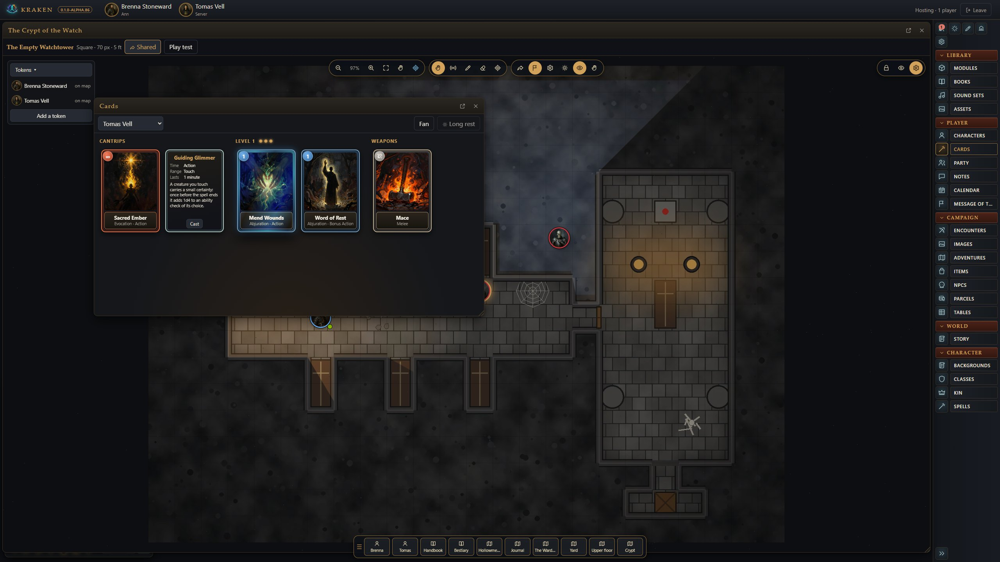
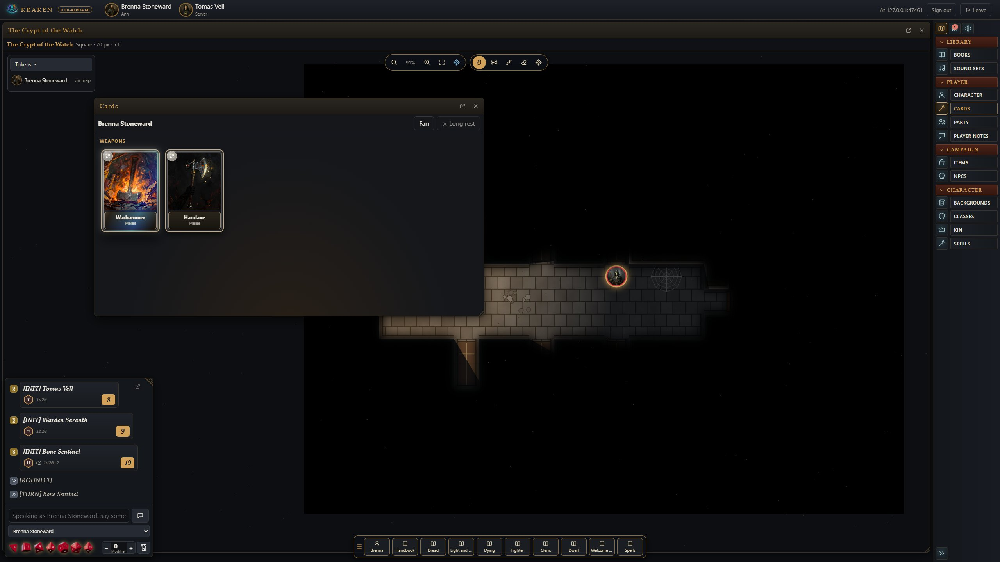

# Kraken VTT

A free virtual tabletop, with its source open to read. The game master runs Kraken on
their Windows or Linux PC and hosts the table; players join from Chrome and install
nothing. It aims for Foundry-level presentation with Fantasy Grounds-level ease
of use, and a built-in AI agent that can do anything the GM can.

> **Alpha test.** Kraken is in alpha (see the version in the app's title bar).
> Expect rough edges, and please report what you find (see
> [Reporting problems](#reporting-problems)).


## Screenshots

| | |
|---|---|
|  |  |
| **The GM's table.** *The Empty Watchtower*'s crypt in torchlight, with the party, the Warden and his Bone Sentinels. | **Combat.** Initiative, Defense and Health, each creature's attacks ready to roll, with the rolls in chat. |
|  |  |
| **A player's view, in Chrome.** Only what their character can see: walls block sight, and the dark hides what the light does not reach. | **Character sheets.** A Descending Darkness cleric, with Defense, Health and the Dread track. Every new character gets a portrait for its kin and class, or Origin and Path. |
|  |  |
| **Ability cards.** Turn them on in Settings and a character's spells and weapons become cards with painted pictures. Click one to turn it over and cast; drag it onto a token to target and cast in one move. | **A player's hand.** Spent cards tip over and go grey; a long rest stands them up again. |
|  |  |
| **Apeira Astra.** *Salvage Rights*: boarding the *Kestrel's Due*, with Mags Orrin's record from the Threat Dossier. | **A crew member.** 2d6 tasks with Difficulty and Boon or Bane, Stamina and Armour. |
|  |  |
| **Books.** The Player's Handbook open on Dread, beside the Warden's record and portrait from the Bestiary. | **Six start screens.** Fantasy, science fiction and horror, one at random each time. |

## What it does

- **Host from your PC, players use a browser.** Create a campaign, press Play,
  and give your players the address, port and password. They see only what you
  let them see: hidden tokens, GM notes and secret doors never reach them.
- **Games you can play today.** Two original games come with Kraken, each with
  its rules, books and a first adventure with maps, art and handouts:
  - **Descending Darkness**: dark fantasy on the d20, with fragile heroes,
    light that runs out and dread that builds. Adventure: *The Empty
    Watchtower*.
  - **Apeira Astra**: science fiction on 2d6 and skills, with crews made in
    minutes and armour that soaks. Adventure: *Salvage Rights*.

  Kraken also plays **Castles & Crusades**, **D&D 5E** (the SRD), **D&D 3.5E**
  (base attack and iterative attacks, criticals by threat and confirmation,
  Fortitude, Reflex and Will, skills by ranks), **AD&D 2E** (THAC0 and
  descending Armor Class, the five saving throws, thief skills,
  multi-classing, your books' pregens), **Traveller** (Mongoose Traveller 2E:
  the UPP, skills and specialities, 2d6 tasks with Effect, careers and terms,
  damage to Endurance, Strength and Dexterity, armour and AP) and a
  rules-free **Worldbuilding** mode for any system.
- **Your Fantasy Grounds library.** If you own Fantasy Grounds modules, Kraken
  reads them in place: books to read, story, encounters, NPCs, items, and maps
  with their walls, doors and lights.
- **Kraken packs.** Make each of your books into Kraken's own file (`.kpack`)
  once, in Books > Packs. Copy the packs folder to any computer and your books
  open there in Kraken, with no Fantasy Grounds installed.
- **Maps.** Image maps and animated tokens, square and hex grids, walls and doors,
  line of sight and fog, lights and darkness, weather, drawing, and a full map
  editor.
- **Character sheets and wizards** for each game, a combat tracker that rolls
  attacks, damage, saves and initiative and applies the results, 3D dice,
  effects, a party sheet and treasure parcels.
- **Sound.** One-shots, sound effects triggered by the chat (a sword hit, a
  fireball), ambience and music, each with its own volume for every player.
- **A multi-monitor GM.** Every window can pop out to another monitor.
- **AI-first.** Every GM action is also a tool for an AI agent (MCP), so an
  assistant can build characters, run combat or set up a map. See
  [AGENT.md](AGENT.md).

## Getting started

1. **Install.** From [Releases](https://github.com/krakenunbound/kraken-vtt/releases):
   - **Windows:** download `Kraken.VTT.Setup.exe` and run it (it is not
     code-signed: if Windows SmartScreen stops it, choose *More info*, then
     *Run anyway*).
   - **Linux (x64):** download the `.AppImage`, make it executable
     (`chmod +x Kraken-VTT-*.AppImage`) and run it; or on Debian and Ubuntu
     install the `.deb` (`sudo apt install ./kraken-vtt_*_amd64.deb`). If
     your firewall is on, allow the port your table uses (for example
     `sudo ufw allow 47300/tcp`).

   Or run from the source (see [Development](#development)).
2. **Make a campaign.** On the start screen choose **My Campaigns**, name it,
   and pick its game. Choose *Descending Darkness* or *Apeira Astra* to try
   Kraken with no other content.
3. **Host.** Choose LAN, Cloud or both, set a password if you like, and press
   **Play**. *Addresses to give your players* lists the addresses.
4. **Players join.** They open the address in Chrome, type their name and a
   password of their own (Chrome remembers it), plus the table's password if
   you set one, and make a character.

The full guides:

| Guide | For |
|---|---|
| [docs/gm-guide.md](docs/gm-guide.md) | Running a game: campaigns, hosting, books, maps, combat, sound |
| [docs/players.md](docs/players.md) | Joining a table, making a character, rolling |
| [docs/included-games.md](docs/included-games.md) | Descending Darkness and Apeira Astra, and running their adventures |
| [docs/development.md](docs/development.md) | Building from source, tests, how the code is laid out |
| [AGENT.md](AGENT.md) | The AI agent and its tools |
| [CHANGELOG.md](CHANGELOG.md) | What changed in each release |
| [PLAN.md](PLAN.md) | The plan and the progress log |

## Development

You need Windows or Linux, [Node.js](https://nodejs.org) 22 or newer, and Git.

```
git clone https://github.com/krakenunbound/kraken-vtt.git
cd kraken-vtt
npm install
npm run build
npm start
```

Or double-click **`Kraken VTT.bat`**: it installs packages the first time,
rebuilds when the code has changed, and opens the app. `npm run exe` builds the
Windows installer and `npm run linux` the Linux AppImage and `.deb` (build
them on Linux, or in WSL). More in [docs/development.md](docs/development.md).

## Reporting problems

Open an issue on GitHub with what you did, what you expected and what
happened, and a screenshot if you can. For a problem a player sees, say which
browser they used.

## Licence and credits

Kraken VTT is free to use and its source is public, under the
[PolyForm Shield License 1.0.0](LICENSE). In short (the licence's own text
decides):

- **You may** use Kraken for anything, including running paid games,
  streaming, and teaching; change it; and share it, with the licence and its
  copyright notice.
- **You may not** use Kraken, or a changed copy of it, to make a product that
  competes with it, such as selling it, repackaging it as your own virtual
  tabletop, or offering it as a hosted service.

For permission beyond the licence, open an issue on GitHub.

The included games (Descending Darkness and Apeira Astra), their books, maps
and art are original to Kraken. Some of Descending Darkness's mechanics are
based on the System Reference Document 5.1 by Wizards of the Coast LLC,
available under the Creative Commons Attribution 4.0 International licence;
no SRD text is reproduced. Kraken's D&D 5E support uses the SRD 5.2.1 under the
same licence. Kraken's D&D 3.5E rules are its own code, written to play as the
System Reference Document 3.5 describes; no SRD text is included. Kraken's
AD&D 2E rules are its own code (the game's mechanics, no book text); the 2E
content is the GM's own books.

Kraken is not affiliated with SmiteWorks (Fantasy Grounds), Foundry Gaming
(Foundry VTT), Troll Lord Games (Castles & Crusades) or Wizards of the Coast.
No licensed content is included: Kraken reads the modules you own, where they
are on your computer.
