# Kraken VTT

A free virtual tabletop, with its source open to read. The game master runs Kraken on
their Windows or Linux PC and hosts the table; players join from Chrome and install
nothing. It aims for Foundry-level presentation with Fantasy Grounds-level ease
of use, and a built-in AI agent that can do anything the GM can.

> **Alpha test.** Kraken is in alpha (see the version in the app's title bar).
> Expect rough edges, and please report what you find (see
> [Reporting problems](#reporting-problems)).


## Screenshots

Full-screen captures from Kraken's own games, *Descending Darkness* and *Apeira Astra*. Shots marked "in Chrome" are what a player sees in a browser.

### The GM's table

*The Empty Watchtower*'s crypt in torchlight: the party, the Warden and his Bone Sentinels, a blue lantern, and ash drifting in the dark. The quick slots along the bottom hold sheets, books, handouts and maps, one click away.

### What a player sees (in Chrome)

Only what their character can see. Walls block sight, and the dark hides whatever the light doesn't reach. The GM's walls, doors and hidden creatures never reach the player's browser.

### Combat

Initiative, Defense and Health, each creature's attacks ready to roll, and the results applied for you.
- **Back** undoes the last turn change: effects that ran out come back, and ongoing damage is healed.
- **‹ Round ›** moves the round back or on.
- Click or drag the turn arrow to give anyone the turn.

### Your turn (in Chrome)
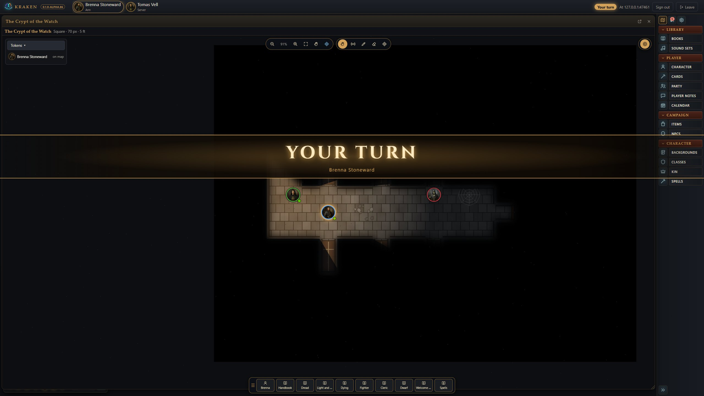
When a player's turn comes round, a banner sweeps across their screen and a bell rings. Each player turns either on or off in **Settings > You at the table**, where they also pick their colour.

### Shapes on the map (in Chrome)
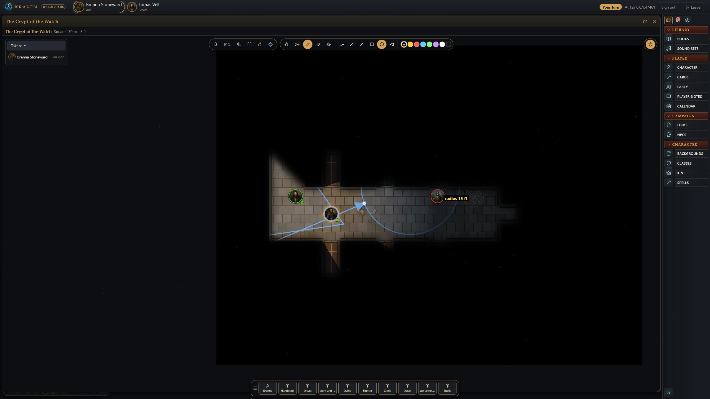
Anyone can draw arrows for direction and aim, cones from their point, circles from their centre, squares and lines.
- Each shape is measured in feet as you draw it, and drawn in your colour, so everyone knows who drew what.
- Drag a shape's handles to resize it.

### Death markers
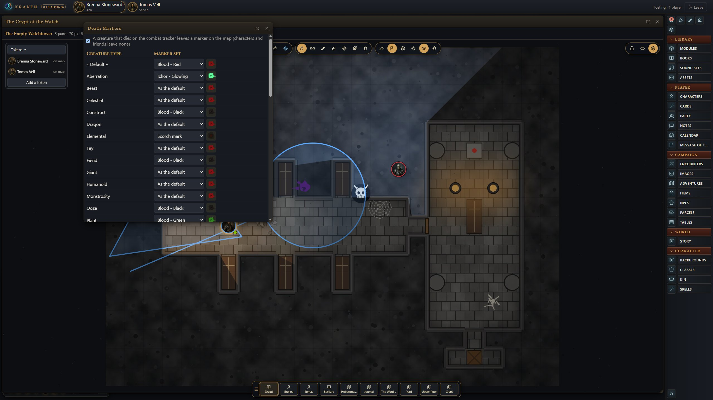
A creature that dies leaves a mark where it fell: blood in its colour, a skull, a tombstone, bones or a scorch mark. The GM chooses the set for each creature type of the game. Undead start violet; constructs start black.

### The map editor
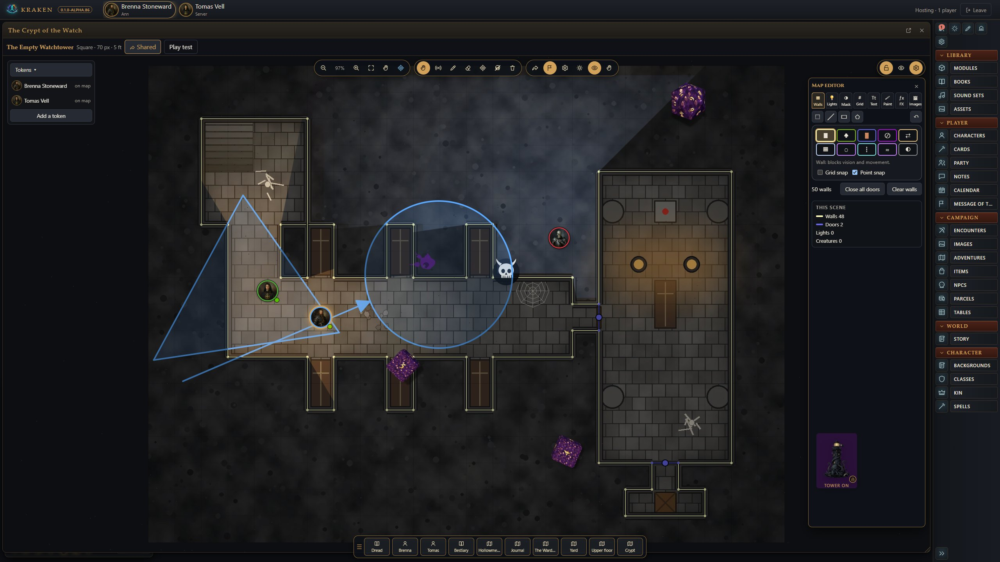
Unlock a map to edit it.
- **Walls and doors:** drawn where your hand puts them, with snapping to the grid and to wall ends.
- **Lights and masks.**
- **Paint, text and pins.**
- **Weather and effects.**
- **Image layers.**

All of it applies to the same master image wherever it's opened. Lock it again to play.

### The dice tower, and dice packs
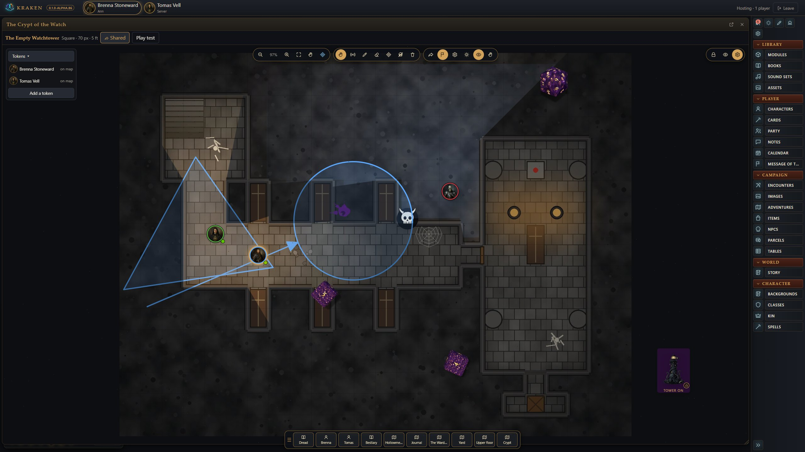
**The dice tower** can stand anywhere on the table.
- Right-click it to lock it in place or fix it at an exact spot.
- It has six drawn looks and several painted towers. This one is the Kraken Lighthouse, lit while it's on.
- Hold dice over it and it comes alive.

**The dice** here are picture dice from a **dice pack**: a folder holding `dice.json` and its textures. Drop one in `Documents/Kraken VTT/Dice` and everyone at the table can use it.

### The Dice window
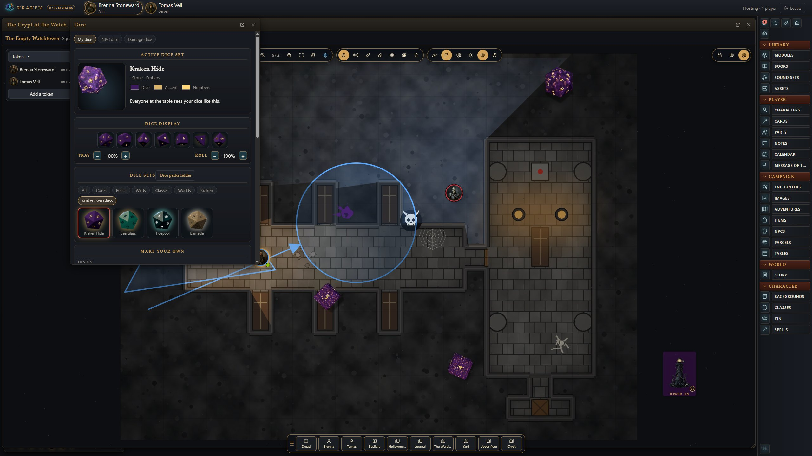
Dozens of 3D dice sets in glass, metal, stone and enchanted finishes, plus each dice pack's sets in a group of their own. Each person keeps their own dice, their NPC dice and their damage dice.

### The Calendar
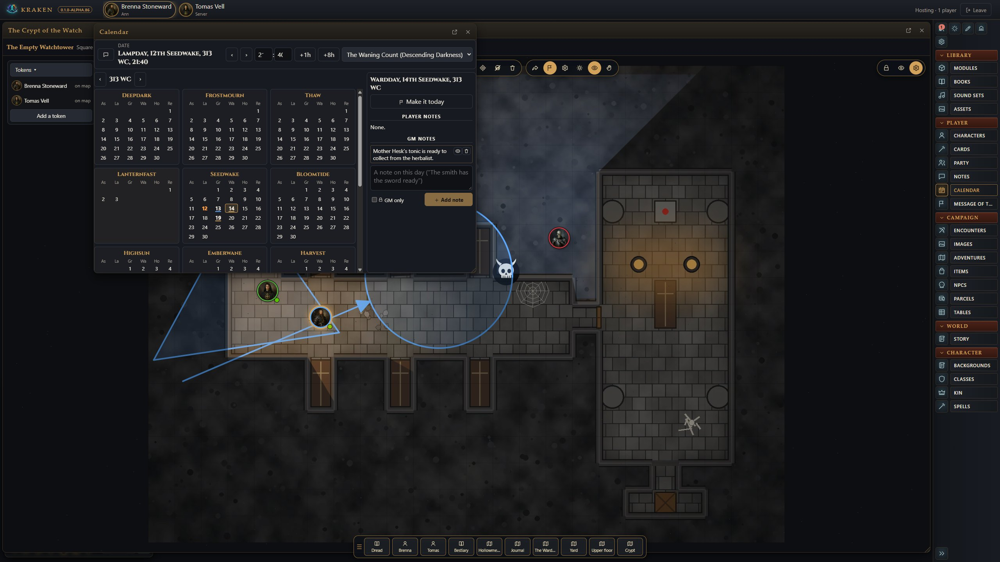
Each game has its own calendar: Greyhawk, Harptos, Golarion, Traveller's Imperial date, and Kraken's own.
- The GM moves the day on, adds eight hours for a rest, and posts the date in chat.
- Anyone writes notes on a day. A player's note is signed in their colour; a GM's note is shown to the players or kept private.

### Message of the Day (in Chrome)
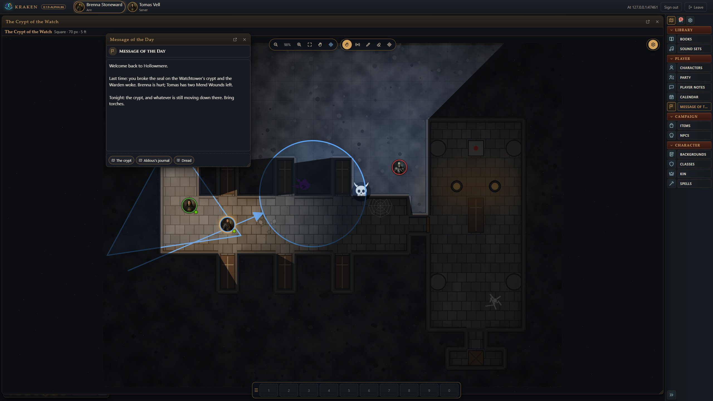
The GM's words for the session, with links to a map, a handout or a rules page. It opens on each player's screen as they join.

### Read aloud (in Chrome)
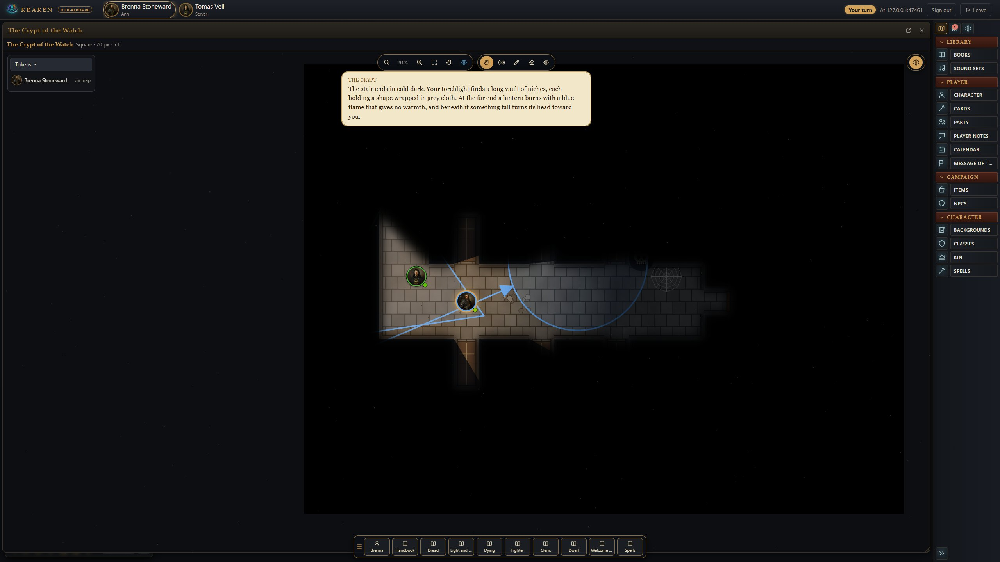
An adventure's boxed text has a button for the GM. The words go to chat and appear over every player's map as a speech bubble.

### Books

Every book is read in Kraken: rulebooks, bestiaries and adventures, with their pictures, maps and links. The Player's Handbook is open here on Dread, beside the Warden's record from the Bestiary.

### Character sheets

A Descending Darkness cleric, with Defense, Health and the Dread track. Every roll on the sheet goes to the table's 3D dice.

### Ability cards

A character's spells and weapons as painted cards. Click one to turn it over and cast, or drag it onto a token to target and cast in one move.


A player's hand. Spent cards tip over and go grey, and a long rest stands them up again.

### The desktop: a hex grid on black
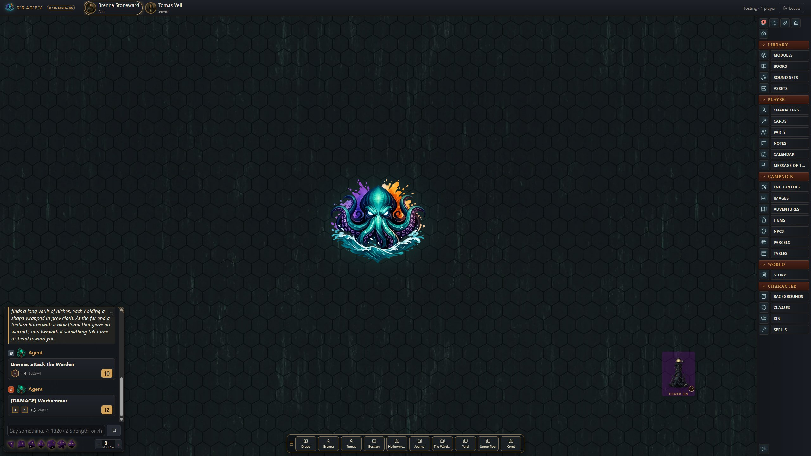
Game-table wallpapers: hex grids, a battle mat, a dungeon map, an old world map, and a sci-fi set. They're big and seamless, so the repeat hardly shows. Your own go in `Documents/Kraken VTT`, beside your dice packs, dice towers, GM icons and decals. Each folder has a guide for you, and one for an AI agent.

### Map Studio
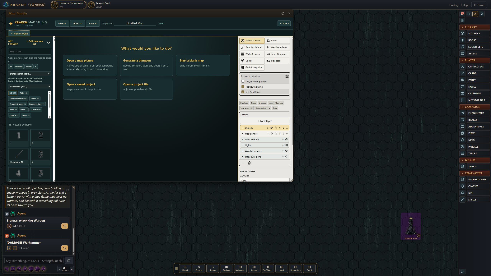
Kraken's own map maker.
- **Painting:** paint from art packs, generate a dungeon.
- **Walls and doors:** drawn with art along them.
- **Lighting and weather:** add lights and weather.
- **Play testing:** try the map out, then save it straight into the campaign's images.

### Apeira Astra

*Salvage Rights*: boarding the *Kestrel's Due*, with Mags Orrin's record from the Threat Dossier and the crew in combat.


A crew member's sheet: 2d6 tasks with Difficulty and Boon or Bane, Stamina and Armour.

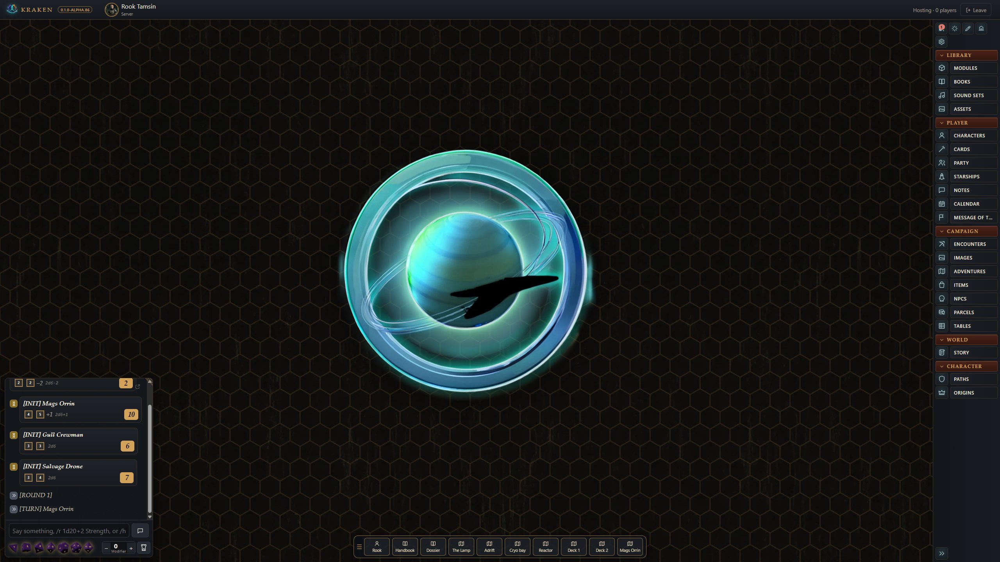
The sci-fi set: an amber hex grid on black, with the Ringed World decal.

### Start screens

Six start screens, fantasy, science fiction and horror, one at random each time. Updates are offered here, and only here: never during a game.

| | |
|---|---|
|  | 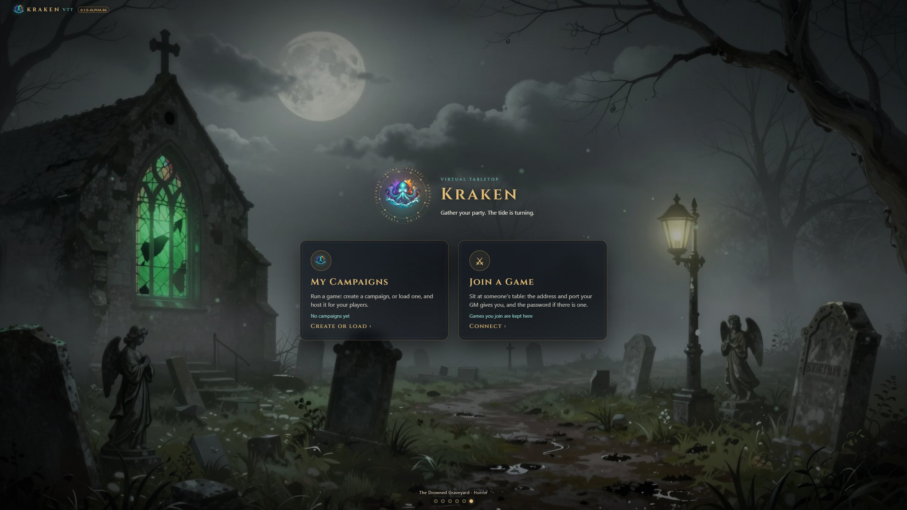 |

## What it does

- **Host from your PC, players use a browser.** Create a campaign, press Play,
  and give your players the address, port and password. They see only what you
  let them see: hidden tokens, GM notes and secret doors never reach them.
- **Games you can play today.** Two original games come with Kraken, each with
  its rules, books and a first adventure with maps, art and handouts:
  - **Descending Darkness**: dark fantasy on the d20, with fragile heroes,
    light that runs out and dread that builds. Adventure: *The Empty
    Watchtower*.
  - **Apeira Astra**: science fiction on 2d6 and skills, with crews made in
    minutes and armour that soaks. Adventure: *Salvage Rights*.

  Kraken also plays **Castles & Crusades**, **D&D 5E**, **D&D 3.5E**
  (base attack and iterative attacks, criticals by threat and confirmation,
  Fortitude, Reflex and Will, skills by ranks), **AD&D 2E** (THAC0 and
  descending Armor Class, the five saving throws, thief skills,
  multi-classing, your books' pregens), **Traveller** (Mongoose Traveller 2E:
  the UPP, skills and specialities, 2d6 tasks with Effect, careers and terms,
  damage to Endurance, Strength and Dexterity, armour and AP) and a
  rules-free **Worldbuilding** mode for any system.
- **Your Fantasy Grounds library.** If you own Fantasy Grounds modules, Kraken
  reads them in place: books to read, story, encounters, NPCs, items, and maps
  with their walls, doors and lights.
- **Kraken packs.** Make each of your books into Kraken's own file (`.kpack`)
  once, in Books > Packs. Copy the packs folder to any computer and your books
  open there in Kraken, with no Fantasy Grounds installed. Kraken's own books
  ship as packs too ([the format](docs/kraken-pack-format.md)).
- **Map Studio, Kraken's map maker.** Paint maps from art packs, walls and
  doors with art along them, lights, weather with masks, traps and regions,
  a dungeon generator and play testing, saved straight into Kraken's images.
- **Maps.** Image maps and animated tokens, square and hex grids, walls and doors,
  line of sight and fog, lights and darkness, weather, drawing, and a full map
  editor.
- **Character sheets and wizards** for each game (with your own Fantasy
  Grounds character wizard extensions, Kraken runs or follows them page for
  page), a combat tracker that rolls
  attacks, damage, saves and initiative and applies the results, 3D dice,
  effects, a party sheet and treasure parcels.
- **Sound.** One-shots, sound effects triggered by the chat (a sword hit, a
  fireball), ambience and music, each with its own volume for every player.
- **At the table.** A banner and a bell when it is your turn, your colour on
  your tokens, pings and drawings, shapes on the map (arrows, circles, cones,
  measured as you draw), death markers where creatures fall, a calendar with
  notes for each game, a message of the day, and FG's read-aloud boxes.
- **Make it yours.** `Documents/Kraken VTT` has a folder for each thing you
  can add: dice packs, dice towers, GM icons, background decals, wallpapers
  and books. Each holds a README on what goes in it and how to make one, for
  you or for an AI agent.
- **A multi-monitor GM.** Every window can pop out to another monitor.
- **AI-first.** Every GM action is also a tool for an AI agent (MCP), so an
  assistant can build characters, run combat or set up a map. See
  [AGENT.md](AGENT.md).

## Getting started

1. **Install.** From [Releases](https://github.com/krakenunbound/kraken-vtt/releases):
   - **Windows:** download `Kraken.VTT.Setup.exe` and run it (it is not
     code-signed: if Windows SmartScreen stops it, choose *More info*, then
     *Run anyway*).
   - **Linux (x64):** download the `.AppImage`, make it executable
     (`chmod +x Kraken-VTT-*.AppImage`) and run it; or on Debian and Ubuntu
     install the `.deb` (`sudo apt install ./kraken-vtt_*_amd64.deb`). If
     your firewall is on, allow the port your table uses (for example
     `sudo ufw allow 47300/tcp`).

   Or run from the source (see [Development](#development)).
2. **Make a campaign.** On the start screen choose **My Campaigns**, name it,
   and pick its game. Choose *Descending Darkness* or *Apeira Astra* to try
   Kraken with no other content.
3. **Host.** Choose LAN, Internet or both, set a password if you like, and press
   **Play**. *Addresses to give your players* lists the addresses.
4. **Players join.** They open the address in Chrome, type their name and a
   password of their own (Chrome remembers it), plus the table's password if
   you set one, and make a character.

The full guides:

| Guide | For |
|---|---|
| [docs/gm-guide.md](docs/gm-guide.md) | Running a game: campaigns, hosting, books, maps, combat, sound |
| [docs/players.md](docs/players.md) | Joining a table, making a character, rolling |
| [docs/included-games.md](docs/included-games.md) | Descending Darkness and Apeira Astra, and running their adventures |
| [docs/development.md](docs/development.md) | Building from source, tests, how the code is laid out |
| [AGENT.md](AGENT.md) | The AI agent and its tools |
| [CHANGELOG.md](CHANGELOG.md) | What changed in each release |
| [PLAN.md](PLAN.md) | The plan and the progress log |

## Development

You need Windows or Linux, [Node.js](https://nodejs.org) 22 or newer, and Git.

```
git clone https://github.com/krakenunbound/kraken-vtt.git
cd kraken-vtt
npm install
npm run build
npm start
```

Or double-click **`Kraken VTT.bat`**: it installs packages the first time,
rebuilds when the code has changed, and opens the app. `npm run exe` builds the
Windows installer and `npm run linux` the Linux AppImage and `.deb` (build
them on Linux, or in WSL). More in [docs/development.md](docs/development.md).

## Reporting problems

Open an issue on GitHub with what you did, what you expected and what
happened, and a screenshot if you can. For a problem a player sees, say which
browser they used.

## Licence and credits

Kraken VTT is free to use and its source is public, under the
[PolyForm Shield License 1.0.0](LICENSE). In short (the licence's own text
decides):

- **You may** use Kraken for anything, including running paid games,
  streaming, and teaching; change it; and share it, with the licence and its
  copyright notice.
- **You may not** use Kraken, or a changed copy of it, to make a product that
  competes with it, such as selling it, repackaging it as your own virtual
  tabletop, or offering it as a hosted service.

For permission beyond the licence, open an issue on GitHub.

Map Studio's art pack (Kraken Map Art) is original to Kraken; Battle Map
Forge's generator and pack are included with its author's permission.

The included games (Descending Darkness and Apeira Astra), their books, maps
and art are original to Kraken. Some of Descending Darkness's mechanics are
based on the System Reference Document 5.1 by Wizards of the Coast LLC,
available under the Creative Commons Attribution 4.0 International licence;
no SRD text is reproduced. Kraken's D&D 5E and D&D 3.5E rules are its own
code (the games' mechanics, no book text); the 5E and 3.5E content is the
GM's own books, played from the rulebooks they own (or an SRD module). Kraken's
AD&D 2E rules are its own code (the game's mechanics, no book text); the 2E
content is the GM's own books.

Kraken is not affiliated with SmiteWorks (Fantasy Grounds), Foundry Gaming
(Foundry VTT), Troll Lord Games (Castles & Crusades) or Wizards of the Coast.
No licensed content is included: Kraken reads the modules you own, where they
are on your computer.
