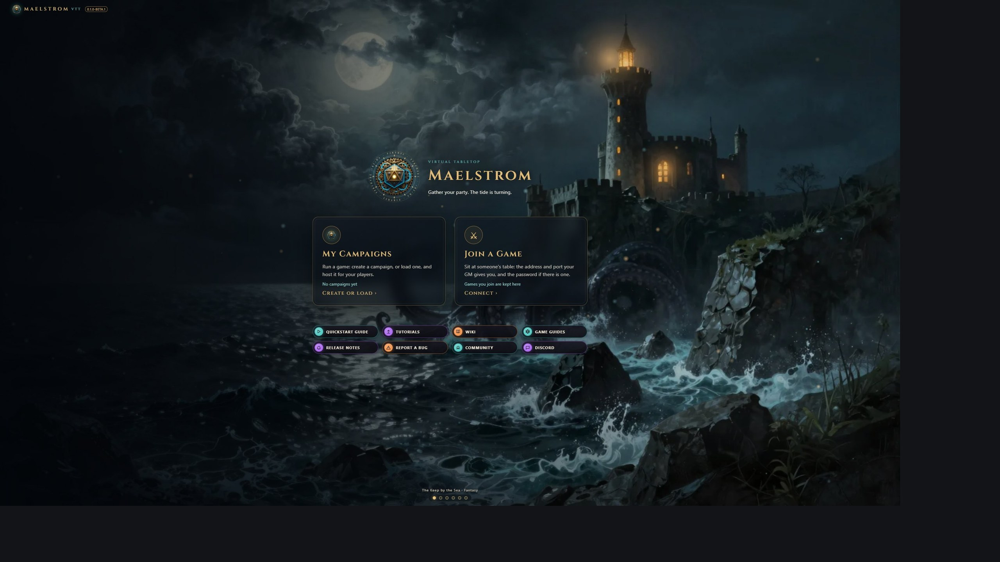

# Campaigns and backups

A campaign is one game you run: its ruleset, its characters, its maps, notes and story. This page covers making campaigns, choosing a game, the campaign menu, and the backups Maelstrom makes for you. Campaigns are saved as you play, in Maelstrom's data folder (`%APPDATA%\kraken-vtt` on Windows, `~/.config/kraken-vtt` on Linux).

## Making a campaign

On the start screen choose **My Campaigns**, then **New campaign**:

- **Name:** whatever you like.
- **Game (ruleset):** the game decides the character sheets, the rules the combat tracker uses, and which books fit the campaign. The rulesets fill as many columns as the window holds, and the chosen one's full description is shown below them. See [Games](games.md).

A campaign made with one of Maelstrom's included games sees that game's own books. A campaign for Castles & Crusades, D&D 3.5E, AD&D 2E or Traveller uses your own books for its content (see [Records, books and packs](records-books-and-packs.md)). **Worldbuilding** has no rules at all: maps, tokens, chat and dice for any game.

### Your own ruleset pictures

Each ruleset shows Maelstrom's own emblem on the picker. To show a picture of your own instead (a logo from your books, say), put it in `%APPDATA%\kraken-vtt\assets\rulesets` (on Linux, `~/.config/kraken-vtt/assets/rulesets`), named after the ruleset: `D&D 3.5E.png`, `Castles & Crusades.webp`. It shows on your computer only. Maelstrom never ships a game's official logo.

## The campaign menu

Click the **⋯** on a campaign's card, or right-click the card:

| Item | What it does |
|---|---|
| **Rename** | Gives the campaign a new name. |
| **Duplicate** | Makes a copy, with its records, adventure and Map Studio pictures. |
| **Export .zip** | One file of the whole campaign, to keep or to move. |
| **Backups and restore** | The campaign's backups by date (see below). |
| **Open folder** | Opens the campaign's folder. |
| **Delete** | After you confirm, sends it to the recycle bin, where you can get it back. |

The menu does not work on the campaign you are playing: leave the table first.

## Backups

Maelstrom backs a campaign up by itself:

- each time you press **Play**, and
- every hour while you host.

The newest ten are kept. **Backups and restore** lists them by date:

- **Restore** puts one back. What was there before is kept as a backup too, so a restore can be undone.
- **Back up now** makes one straight away.

For extra safety, also keep a copy of your `Documents/Kraken VTT` folder, which holds your packs, dice and pictures (see [Settings](settings.md#your-maelstrom-vtt-folder)).

## Logs

When something goes wrong, **Settings > Open logs** opens the folder of Maelstrom's logs (the table server's and the window's). Attach them to a bug report. See [Troubleshooting and FAQ](troubleshooting-and-faq.md).
