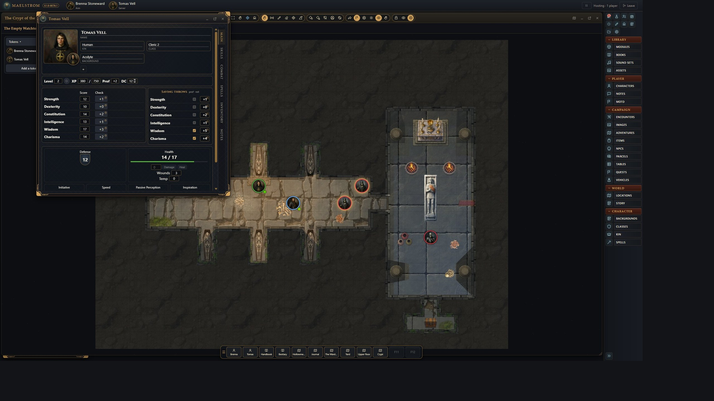
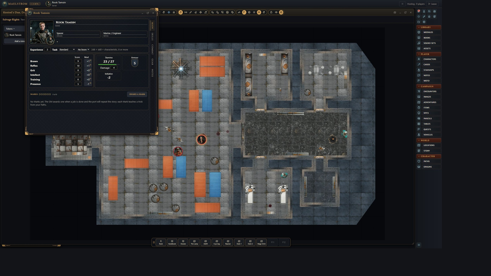
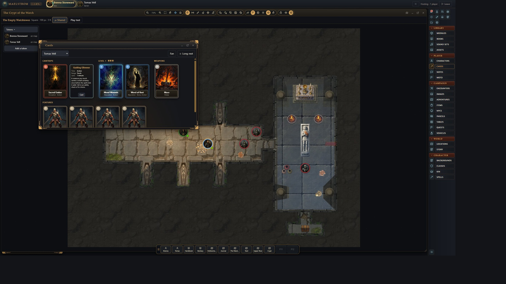

# Character sheets and wizards

Every game in Maelstrom has its own character wizard and its own sheet, built on one shared frame so they all work the same way. This page covers Character Selection, making a character, the sheet, levelling up, the party sheet, and how loot reaches the characters.

## Character Selection

The sidebar's **Characters** opens Character Selection, for the GM and every player, as in Fantasy Grounds. Every character shows as a card (for the GM, all of them).

- **A card** opens its sheet. A character the GM has **released** opens for a player to look over (nothing is theirs yet); its **Take** button makes it theirs. Characters the GM keeps are marked *The GM's* and cannot be taken.
- **New character** runs the game's wizard.
- **Create** makes a blank character to fill in by hand.
- **Import** brings a character in from a file.
- **Edit mode** (the pencil) shows each card's **Export**, and the GM's **Delete**.

The portrait bar along the top of the screen shows the characters at the table.

### Who holds a character (the GM's)

Right-click a character's portrait (or its card in Character Selection):

- **Give to (a player at the table):** they hold it, and its tokens on every map become theirs. Steve can't come tonight, so Brenda plays Zifnab; next week, give him back to Steve.
- **Release to the players:** no one holds it, and players may open it to look it over, then take it. Use it for pregens when a player's character dies.
- **Keep as the GM's:** no player holds or sees it.

A character stays with its player's account: it is theirs every time they sign in, from the app or any browser.

## The character wizards

Players make their own characters in the wizard, or the GM makes one for them. Each wizard follows its game's book, step by step. Wizard rolls are the host's, made in chat for the table. Starting gear is bought with the starting money in each wizard's shop.

| Game | What the wizard does |
|---|---|
| Descending Darkness | Kin, class, background and abilities (standard array 17, 14, 14, 13, 12, 8). |
| Apeira Astra | Origin, a major and a minor Path, skills and gear. |
| D&D 5E | Species, class, background, scores, skills, gear (class and background kits, as Fantasy Grounds does) and spells. Follows FG's 5E wizard. |
| D&D 3.5E | Race, class, level and scores. |
| AD&D 2E | Race, class or multi-class, level, scores and 18/xx, or one of your books' pregenerated characters as it is. |
| Castles & Crusades | Follows your Fantasy Grounds C&C wizard extension. |
| Traveller | The lifepath, term by term with the table's dice: characteristics, background skills, education, careers, events, mishaps, promotions, aging, benefits. Only the GM may re-roll characteristics. |
| Basic Fantasy | 3d6 in order, race and class limits, the hit die, 3d6 x 10 gp and the shop, a Magic-User's first spell. |
| Cairn | A background with its names, gear and two tables, attributes, HP, traits, a Bond, the age, the Omen, and 3d6 gold at the Marketplace. |
| Fate Core / Fate Accelerated | High concept, trouble, the phase trio, the skill pyramid or approaches, and stunts; or a pregenerated character. |
| Forged in the Dark | A scoundrel from a playbook; the crew has its own wizard. |

The 2E, 3.5E, 5E and C&C wizards follow Fantasy Grounds' wizard extensions and FG's 5E wizard, art and words included. Traveller's wizard is the KrakenCharWizardMGT2 extension itself, run inside Maelstrom: it needs the extension in Fantasy Grounds' extensions folder once, and Maelstrom keeps a copy beside the packs.

## The sheet

- Click a skill, save, attack or anything else that can be rolled to roll it. Rolls go to the table's 3D dice and to chat.
- **Drag** races, classes, spells and items from a list or a book onto a sheet, as in Fantasy Grounds. A class arrives at 1st level with its hit points; a race replaces the old one; a spell is bound to its class; an item goes into the gear.
- **The tab rail** along the sheet's right edge switches pages.
- **The buff bar** shows the effects on the character.
- **Supplies** (on the Inventory tab) counts ammunition, potions, rations, torches and the load; see [Bookkeeping and rest](bookkeeping-and-rest.md).
- **D&D 5E** has an **Inspiration** box players may tick.

Each game's sheet adds its own parts: Dread in Descending Darkness, Marks and tricks in Apeira Astra, Moves and progress tracks in Ironsworn, aspects and stress in Fate, harm and load in Forged in the Dark, the Growth tab in Cairn. See [Games](games.md).

## Levelling up

Experience and levelling follow each game's rules. The sheet's level up rolls or adds hit points by the game. Some games grow differently:

- **Apeira Astra:** no levels. Experience buys skills and characteristics with **Improve**; the GM awards **Marks** (Main page, **Award a Mark**, at most six), and the player learns a trick with each.
- **Cairn:** no levels or experience; the **Growth** tab.
- **Fate:** milestones.
- **Forged in the Dark:** xp per attribute and playbook, and advances.

## The party sheet

The party sheet (sidebar, **Player > Party**) holds the party's members, coin and items.

- **XP:** award XP, and drop quests and encounters on its XP tab. `/award 50` in chat awards XP too.
- **Hand out** coin and items to the characters.
- **The group roll:** a check, save or skill for everyone, rolled for them or asked of the players.
- **Rest the party:** a short or long rest for everyone.
- Some games add a tab: Cairn's **Growth**, Fate's **Milestones**, Forged in the Dark's **Crew**.

## Parcels and treasure

**Campaign > Parcels:** drop items in, add coins in the game's money, then **To the party sheet** or **Give** to a character. A random table can roll straight into a parcel. Items can be unidentified; see [Records, books and packs](records-books-and-packs.md#identifying-items).

## Starships

In *Traveller* and *Apeira Astra*, **Starships** (sidebar) holds the campaign's ships. Make one from a design, let the crew take stations with their characters, and put the ships on the tracker; gunners fire from the ship's sheet (target, range, Fire). **On the map** puts a ship's token on the open map (the range is then read from the map), and **Deck plans** opens its decks as maps with walls and doors.

## Ability cards

Players can show their spells and weapons as painted cards: turn on **Ability cards** in Settings. See [Joining a table](players-joining.md#ability-cards).

