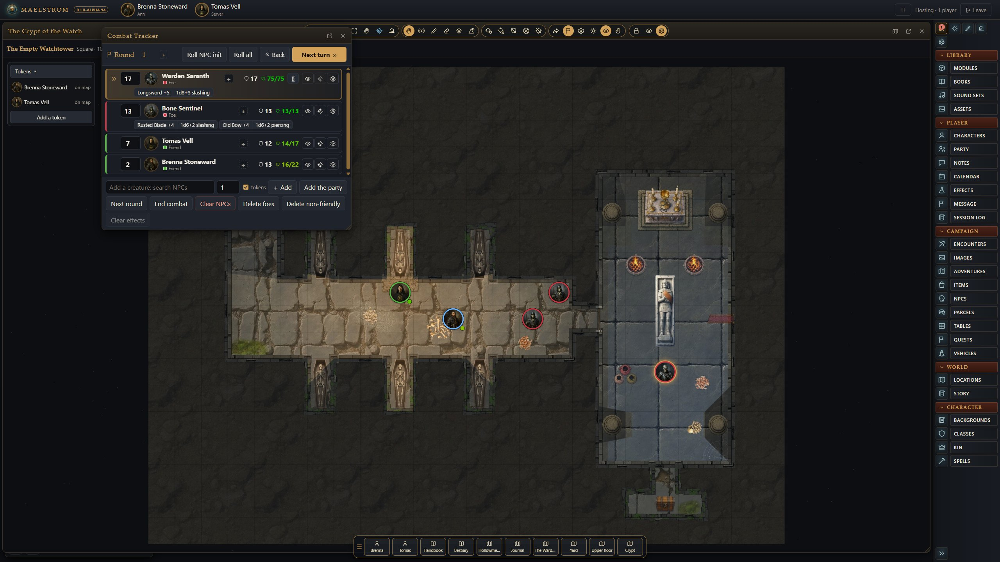

# Combat tracker

The combat tracker runs a fight by the campaign's game rules. It rolls initiative, attacks, damage and saves, applies the results, ticks effects at each turn, and keeps everyone's turn order in view. This page covers adding creatures, running turns, correcting mistakes, encounters, the tracker's options, and what happens after the fight.

## Adding creatures

- Drag characters and creatures into the tracker.
- Add them from an encounter (see below).
- Or use the tracker's search box.

**Settings > Combat > Creatures' hit points** decides a creature's hit points as it joins: **As listed** in its book, **Rolled** from its hit dice each time (no two goblins alike), or **Maximum**.

**NPC numbering** names a creature added again: in order (Goblin 1, Goblin 2), with a random number (Goblin 14), or left as it is.

## Running the fight

1. Press **Roll initiative**.
2. Step through the turns with **Next turn**, and **Next round** to move the round on. Effects tick at each turn, and durations count down.
3. On a creature's turn, roll its attacks and damage from its sheet or its tracker row against the targeted token. Saves, healing and conditions work the same way, by each game's rules.

When a player's turn comes round, they get a banner and a soft chime (each can be turned off in their Settings).

### Delay and Act now

**Delay** on the active row lets a creature wait. **Act now** brings it in at once, after the one acting.

### Corrections

- **Back** returns to the turn before.
- **‹ ›** beside the round moves it back or on.
- Click a row's arrow space (or drag the arrow there) to make it that creature's turn.

**Next turn** and **Next round** run the rules (durations, ongoing damage). **Back** and **Round back** undo those turn changes: effects that ran out come back and ongoing damage is healed, while what happened during the turn stays.

## What players see

What players see of your creatures' health (Settings > Tokens and measuring) counts for the tracker too: nothing, the status, a bar, or the numbers. Damage and healing float off a token as numbers (red down, green up) for the GM, and for players where the tracker shows them numbers; never for a hidden token.

A creature with a **Players call it** name is called that on the players' tracker and in chat.

## Encounters

**Campaign > Encounters** holds the adventures' encounters and the campaign's own.

- **New** makes one. Drop NPCs into it; a count can be dice (`1d4+1`), rolled when they go on.
- **Place on this map:** put the tokens where they go first; it keeps where they stand.
- **Add to tracker** puts the creatures on the tracker.
- **End encounter** gives its XP to the party sheet.

## The tracker's options

In **Settings > Combat** (the GM's):

| Setting | Choices |
|---|---|
| **Clear targets** | Never (as FG), after a spell or an attack's damage, or at the end of the creature's turn. |
| **Initiative** | Each creature rolls its own, or one roll for each kind of creature (all the goblins together). |
| **Creatures' hit points** | As listed, rolled, or maximum. |
| **Roll initiative every round** | At each new round everyone rolls again and the order changes (FG's house rule). |
| **Stop at the start of each round** | A new round waits for your next click before anyone acts. |
| **Skip turns** | The dead and unconscious creatures, characters too, or no one. |
| **NPC numbering** | In order, random, or off. |
| **Token effects** | Conditions on tokens animated, icons only, or off. |
| **Apply damage** | At once (FG), or from the chat card's buttons (Foundry). |

## Each game's buttons

The tracker shows each game's own buttons. Some examples:

- **D&D 5E:** death saves.
- **Descending Darkness:** **Steady**, a Wisdom check against 12 to stop a dying friend's bleeding.
- **AD&D 2E:** initiative lowest first, Death's Door and **Bind wounds**, **Turn undead** for clerics.
- **Basic Fantasy:** d6 initiative, **Turn undead**, a **Morale** button for monsters.
- **Cairn:** **Sides (DEX saves)** starts the fight, attacks always hit, **Morale**, **Stabilize**.
- **Ironsworn and Starforged:** foes as a rank and a progress track; **Harm…** to inflict a foe's harm.
- **Fate:** a physical or mental conflict, **Turn order** without dice, **Concede**.
- **Forged in the Dark:** no initiative; the **Score** button opens the Score panel.

See [Games](games.md) for how each one fights.

## The party sheet's group roll

On the party sheet, pick a check, save or skill, and **Roll** for everyone, or **Ask the players**: each rolls from a card in chat with their own sheet. You can roll for anyone who is away, and the card sums it up.

## After the fight

- The tracker shows **Short rest** and **Long rest** for the whole party (the clock moves on).
- Anyone who shot arrows is offered **Recover** on their sheet for what can be picked up (half, in 5E).

See [Bookkeeping and rest](bookkeeping-and-rest.md).
