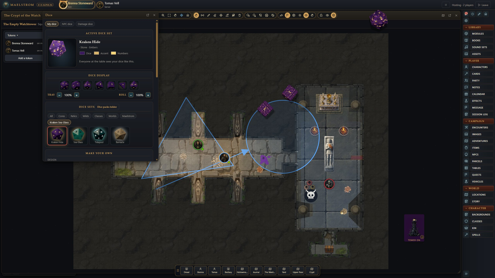
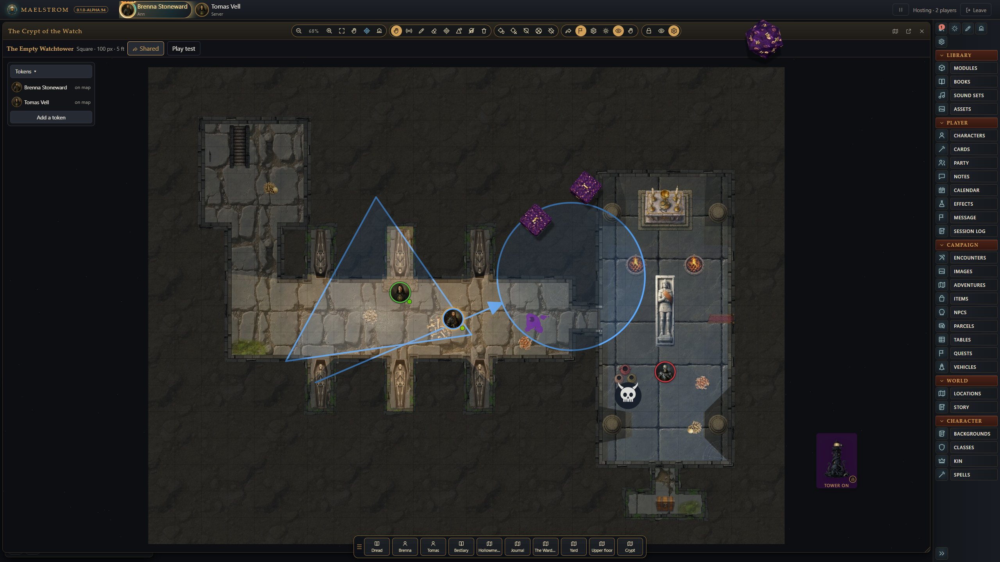

# Dice and chat

Chat is where the table talks and where every roll lands. This page covers rolling (the dice tray, the modifier box, roll modes, 3D dice and the dice tower), talking (whispers, emotes, speaking as an NPC), links and inline rolls in chat, the Session Log, and every chat command. Commands follow Fantasy Grounds' names, with Foundry's where it has its own, so players from either know them.

## Rolling

- **From a sheet:** click anything that can be rolled.
- **From chat:** `/r 1d20+2`. Spaces are allowed, and a label goes after `#` or after the dice: `/r 1d20 + 2 #Climb`.
- **From the tray:** click the dice to roll them.
- **Dice in your hand**, as in Fantasy Grounds: right-click a die and pick how many (3× picks up three). They follow the pointer: click the table to throw them, the tower to roll them there, or a **quick slot** to keep them there (that slot then rolls them with a click or its number key). A right-click or Escape puts them back. You can also drag a single die straight onto a slot.

### Dice formulas

| Formula | Means |
|---|---|
| `1d20+3` | One d20, plus 3. |
| `4d6d1` | Drop the lowest one. |
| `4d6k3`, `2d20kh1` | Keep the highest three; keep the highest one. |
| `3d6!` | Exploding dice. |
| `3d6xo` | Explode once. |
| `4d6r1` | Reroll 1s once. |
| `4d6rr1` | Reroll 1s until they are not 1. |
| `4d6min2`, `4d6max5` | No die below 2; no die above 5. |
| `6d10cs>=7` | Count successes (7 or more). |
| `6d10cf<3` | Count failures (under 3). |
| `1d20ms>=15` | The margin of success against 15. |
| `4dF` | Four Fate dice. |
| `d%` | Percentile. |

### The modifier box

The modifier box beside the dice holds up to six numbers for your next roll, each with a label (FG's modifier stack).

- Type `/mod 2 Flanking`, or drop a number, a chat roll or an effect on the box.
- Right-click one to take it off.
- **The keys** under the tray are the game's own chips: ADV, DIS, +2, -2, and in D&D 5E cover, superior cover, opportunity, and Crit, Max and Half for damage; Traveller and Apeira Astra have Boon and Bane.

Whatever you roll next, from the tray, `/roll`, a sheet or the combat tracker, reads them and lists them on its card; then they clear. In 5E, ADV and DIS tag the roll **[ADVANTAGE]** or **[DISADVANTAGE]**. Every player has their own box.

### Roll modes

The list under the chat sets the mode for every roll you make until you change it:

- **Public:** everyone sees it.
- **GM and me.**
- **Blind:** the GM alone; you see only that you rolled.
- **Self:** only you.

### 3D dice and the dice tower

- 3D dice roll across the table on every screen. Dice from different rolls knock against each other and come to rest side by side.
- **Settings > Dice stay on the table** (the GM's) sets how many seconds landed dice stay before they fade, for everyone.
- A natural 20 on a d20 flares gold to a bugle's fanfare, a natural 1 red to a sad trombone, on every screen that sees the dice (with dice sound on; the flare's switch in the **Dice** window turns both off).
- The **Dice** window sets your dice: sets, colours, material, lettering, effects, 3D and sound. Each person keeps their own dice, their NPC dice and their damage dice.

**The dice tower** is the GM's by default: a roll into it is for the GM's eyes. **Settings > Players see their own tower rolls** lets players see theirs (or `/option towerreveal on`).

**External dice tower** (Settings > Dice tower on the table, the GM's): the tower stands on the table apart from the chat, for everyone, each person placing it where they like (drag it). It is dark when off; on, or while you hold dice over it, its door glows and dice tumble inside. Click it to turn it on or off, or drop dice on it. Right-click it for its menu:

- **Lock it where it stands**, or **Fix it at** x,y.
- Turn it on or off.
- **Change its look…** for everyone: six drawn towers, the Kraken Lighthouse, painted towers, or your own picture in `Documents/Kraken VTT/Dice Towers`.
- **Dock it in the chat.**

### Dice packs

Drop a dice pack (a folder or `.zip` with `dice.json`) in `Documents/Kraken VTT/Dice` and its sets appear in everyone's Dice window, as a group of their own. The README in that folder gives the format, with an example pack to copy.

## Talking

- Type to talk.
- `/w Ann, Bob message` whispers to players. A name can be a player or a character someone holds, and `GM` reaches the GM. The GM sees every whisper, as in FG.
- `/me draws her sword` and `/action` set what you do apart from speech; `/ooc` is out of character; `/mood angry Get out!` says it with a mood.
- **The GM speaks as an NPC** with `/id Name` (and `/id` on its own to stop), and changes the name they are shown by with `/gmid`.
- Words spoken or emoted as a character or creature show over its token for a moment, in a parchment bubble (emotes in italics). Never a whisper or a secret line.
- Lines spoken as a character or an NPC show its portrait.
- The **GM Icon** (Settings > GM Icon) is the picture beside what the GM says.

## Links and inline rolls

- **Links:** drop a record, a book page or a picture (or a result from a random table's window) into the chat's entry. The line carries it, and each player opens it only if they may see it. The share button beside the entry posts the record's text, as the players know it (an unidentified item by its unidentified name).
- **Inline rolls:** `[[1d20+5 #Attack]]` in chat, and the dice a book, story, record or note names ("2d6 + 3 fire"), are chips you click to roll.
- **Action links:** a check, save or skill against a DC in a book's text is a chip too; see [Targeting and effects](targeting-and-effects.md#action-links-in-text).
- **Notes from chat:** drag any chat line into a note, or onto Player Notes to start one.

## Macros

Type a line in chat, such as `/roll 4d6k3`, and drag the hand beside the entry onto a quick slot. The slot runs that line again. See [Keyboard and mouse](keyboard-and-mouse.md#quick-slots).

## Session Log and export

- **Session Log** (the GM's sidebar) keeps each sitting's chat with the campaign. Read it back, or **Export** it to Markdown or a web page.
- Everyone can export the chat they saw from the chat's corner.

## Every chat command

Type `/` to see the commands you may use, and `/help` for all of them. Commands marked GM are the GM's alone: they are not offered to players, and the host refuses them from players anyway. In the arguments, `[...]` is needed and `<...>` is optional.

### Dice

| Command | Arguments | What it does | GM |
|---|---|---|---|
| `/roll`, `/r`, `/die` | `[dice] <for>` | Roll for everyone. All the formulas above work. The modifier box and its keys are added by the host. | |
| `/gmroll`, `/gr` | `[dice] <for>` | Roll so only the GM and you see it. | |
| `/blindroll`, `/br`, `/tower` | `[dice] <for>` | Roll for the GM's eyes only (the dice tower): you see only that you rolled. | |
| `/selfroll`, `/sr` | `[dice] <for>` | Roll so only you see it. | |
| `/publicroll`, `/pr` | `[dice] <for>` | Roll for everyone (as `/roll`). | |
| `/random` | `[number] <for>` | A random number from 1 to that number (2 to 1000): `/random 6`. | |
| `/mod` | `[number] <for>` | Add a number to the modifier box for the next roll: `/mod 2 Flanking`. | |
| `/rollon` | `[table] <-c column> <-d dice> <-hide>` | Roll on a random table: `/rollon Rumours -d 2d6 -hide`. `-c` picks a column, `-d` other dice, `-hide` the GM's eyes only. Players can roll on tables shared with them. | |
| `/check` | `[ability or skill] <DC>` | A check: `/check dex 15`. A player rolls their character's; the GM asks every player for theirs. | |
| `/skill` | `[skill] <DC>` | A skill check: `/skill perception 12`. | |
| `/save` | `<ability> <DC>` | A saving throw: `/save wis 13` (the GM asks the players). Typed alone by the GM, `/save` saves the campaign. | |

### Talk

| Command | Arguments | What it does | GM |
|---|---|---|---|
| `/emote`, `/em`, `/me` | `[what you do]` | Say what you do: `/me draws her sword`. | |
| `/action`, `/act` | `[action]` | An action, set apart from speech. | |
| `/ooc` | `[message]` | Out of character. | |
| `/ic`, `/say` | `[message]` | In character, as a plain message. | |
| `/mood` | `[mood] [message]` | Say it with a mood: `/mood angry Get out!` or `/mood (sad) Farewell`. | |
| `/w`, `/whisper` | `[name, name] [message]` | Whisper to players (or GM): `/w Ann Meet me by the well.` The GM sees every whisper. | |
| `/gm` | `[message]` | Whisper to the GM (as `/w GM`). | |
| `/reply` | `[message]` | Whisper back to whoever last whispered to you. | |
| `/vote` | `[question]` | Ask the table yes or no; everyone answers in chat: `/vote Do we rest here tonight?` | |
| `/afk` | | Away from the keyboard: your portrait dims for everyone. Type it again to come back. (The GM is never away: `/pause` instead.) | |

### GM

| Command | Arguments | What it does | GM |
|---|---|---|---|
| `/story` | `[text]` | Story text for the table, without a name. | GM |
| `/id` | `<name>` | Speak as someone (an NPC) until `/id` on its own. | GM |
| `/gmid` | `<name>` | The name the GM is shown by (instead of DM). | GM |
| `/kick` | `[player]` | Send a player away from the table: `/kick Bob`. | GM |
| `/award` | `[xp]` | Award XP to the party: `/award 50`. | GM |
| `/pause` | `[on\|off]` | Pause the game (the players see a veil; their moves and rolls wait), or go on. | GM |
| `/option` | `[name] [value]` | Set a table option: `/option towerreveal on\|off` (players see their own dice-tower rolls). | GM |
| `/play`, `/sfx` | `[folder or sound]` | Play a sound for the table: `/play oneshots/Doors/Wooden Door`. Alone, it opens the Sound window. | GM |

### This screen

These change only your own screen.

| Command | Arguments | What it does | GM |
|---|---|---|---|
| `/clear` | | Clear the chat on this screen. | |
| `/help`, `/?`, `/commands` | | Every command. | |
| `/dice` | | Your dice: sets, colours, effects (opens the Dice window). | |
| `/settings` | | Opens Settings. | |
| `/sound`, `/sounds` | | Sound: your volumes (and the GM's one-shots, ambience, music and triggers). | |
| `/volume` | `[0-100] <kind>` | This screen's volume: everything, or one of oneshots, sfx, ambience, music. `/volume 30 music`. | |
| `/openwindow` | `[window]` | Open a window: characters, character, party, combat, tracker, ct, players, settings, options, dice, sound, sounds, decal, wallpaper, gmicon. | |
| `/closewindow` | `[window]` | Close one of those windows. | |
| `/diceeffect`, `/dice3d` | `[on\|off]` | 3D dice rolling across the table, on this screen. | |
| `/dicevolume` | `[0-100\|on\|off]` | The dice sounds' volume. | |
| `/scaledice` | `[60-160]` | The tray's dice size, in %. | |
| `/scaleroll` | `[50-250]` | The rolled dice's size on the table, in %. | |
| `/scaleui`, `/resizeui`, `/zoom` | `[50-200]` | Make everything on this screen bigger or smaller, in % (100 is normal). Kept in this browser. | |
| `/info`, `/version` | | About Kraken VTT and this table. | |
| `/reload` | | Reload this screen. | |
