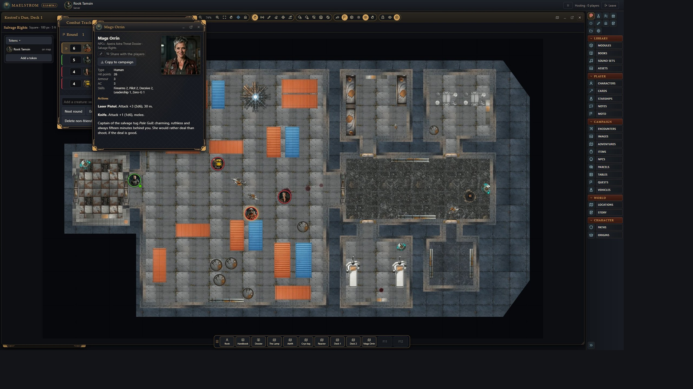

# Games

Ten games come with Maelstrom, so a table can play with nothing else installed: Maelstrom's own *Descending Darkness* and *Apeira Astra*, and eight from open licences. Each has its rules, a character wizard, a sheet, its books, and a first adventure or starter with story, encounters and maps (with walls and doors). Maelstrom also plays five more games from your own books. This page has a section for each.

To play one: make a campaign with the game as its ruleset (see [Campaigns and backups](campaigns-and-backups.md)), then make its books active in **Modules**.

Every included book has a cover, and every creature, NPC and pregenerated character has a portrait and a round map token, each game in its own painted style. That art is Maelstrom's own, made for these books; none of it comes from the games' publishers.

## Descending Darkness (Maelstrom's own, dark fantasy)

The d20 family: roll a d20, add a modifier, beat a number.

- **Fragile heroes.** Characters go to level 10, not 20. Health is lower, and at 0 Health a character is **dying and bleeds** 1 Health at the start of each of their turns until someone steadies them (**Steady** in the combat tracker: a Wisdom check against 12) or they die. There are no death saves.
- **Dread.** A track from 0 to 6 on the sheet. Horrors, the dark and the dead raise it; at 3 a character is Shaken, and worse follows.
- **Kin, classes, backgrounds.** Five kin (Human, Elf, Half-Elf, Dwarf, Gnome), each allowing some of the seven classes (Fighter, Cleric, Wizard, Thief, Paladin, Ranger, Bard), and eight backgrounds.
- **Standard array** 17, 14, 14, 13, 12, 8; Defense instead of AC.

**Books:** *Descending Darkness Player's Handbook* (rules, kin, classes, 36 spells, gear) and *Descending Darkness Bestiary* (18 creatures).

**Adventure: *The Empty Watchtower*** (levels 1 to 2, one or two sessions). The beacon on the ridge above Hollowmere has gone dark, and the dogs will not stop howling. Ten story entries, six encounters, three maps and three handouts. The way through is not only a fight.

## Apeira Astra (Maelstrom's own, science fiction)

Its own 2d6 engine.

- **Tasks.** Roll 2d6 + skill + characteristic modifier against **8**. The margin is the **Effect**: it adds to damage and decides how well things go. Difficulty adds or takes away (Easy +2, Hard -2, and so on). A **Boon** rolls 3d6 and keeps the best two, a **Bane** the worst two. Untrained is -3.
- **Six characteristics:** Brawn, Reflex, Grit, Intellect, Training, Presence. **Stamina** is Brawn + Reflex + Grit. **Armour** subtracts from damage. A character is **Down** at 0 Stamina and dead at minus their Grit.
- **A crew in minutes.** An **Origin** (Coreborn, Spacer, Frontier, Undercity, Belter), a major **Path** (Fleet, Marine, Scout, Merchant, Engineer, Medic, Drifter) and a minor Path. No levels: experience buys skills (to 4) and characteristics (to 15) with **Improve**.
- **Marks and tricks.** The GM awards a **Mark** from the sheet's Main page (**Award a Mark**, at most six in a career). The player then learns a trick from their major or minor Path with it. A trick shows beside the skill it names; the player sets its Boon on the strip when it applies. The GM can take a trick or an unspent Mark back as a correction.
- **Starships:** see [Character sheets and wizards](character-sheets-and-wizards.md#starships).

**Books:** *Apeira Astra Crew Handbook* (rules, Origins, Paths with their tricks, Marks, gear and prices, salvage law) and *Apeira Astra Threat Dossier* (22 threats and contacts, a salvage roll, how to run a job, and six jobs ready to play).

**Adventures:** *Salvage Rights* (a new crew, two sessions): the freighter *Kestrel's Due* is adrift in the Heron belt, and a rival salvager is racing the crew to it. *A Lamp in the Rock* (a new crew, one session): a freighter fused with an asteroid and two stamps on one salvage claim.

## D&D 5E (the SRD 5.2.1)

The System Reference Document 5.2.1 as three books, ready to play with nothing else installed:

- **SRD 5.2.1 Player's Rules** (a players' book): every rules chapter as pages, and what the wizard, sheet and tracker use: 12 classes with a subclass each and their features to level 20, 9 races, 4 backgrounds, the feats, every weapon, armor, tool and piece of gear, and 339 spells. Spells that roll (attacks, saves for half, damage and healing that grow with the slot or level) play on the combat tracker.
- **SRD 5.2.1 Creatures** (the GM's): all 330 monster and animal stat blocks, as NPCs whose attacks roll on the tracker.
- **SRD 5.2.1 Magic Items** (the GM's): the Magic Items chapter and its 258 items.

There is no adventure. Your own 5E modules and packs sit beside these books. The 5E sheet has death saves, Inspiration, and the modifier keys for cover, opportunity, Crit, Max and Half.

## Basic Fantasy RPG, 4th Edition (old-school fantasy)

Classic old-school play, free and open.

- **The wizard follows the book:** 3d6 for each ability in order; a race whose limits the scores meet (Dwarf, Elf, Halfling, Human) and a class it may take (Cleric, Fighter, Magic-User, Thief; an Elf may be a Fighter/Magic-User or a Magic-User/Thief); the hit die + Constitution; 3d6 x 10 gp in a shop that greys out what the class or race may not use; a Magic-User's first spell besides Read Magic.
- **The sheet** works out ability bonuses, ascending Armor Class, the attack bonus, the five saving throws, movement, thief abilities, spells a day and turning the undead. The level up button rolls the hit die to 9th level, then adds the class's fixed hit points. A Human gets +10% experience.
- **The tracker** plays the Encounter rules: d6 + Dexterity initiative, highest first; d20 + attack bonus against AC; saves; dead at 0 hit points; a Cleric's **Turn undead**; the GM's **Morale** button for monsters.

**Books:** *Basic Fantasy Player's Handbook* and *Basic Fantasy Game Master's Guide* (245 monsters, 135 magic items, treasure).

**Adventure: *The Mill at Hob's Ford*** (1st level, one or two sessions, written for Maelstrom). Goblins have moved into the cellars under the village's mill, and they have woken something older below.

## Cairn, Second Edition (dark fairy-tale fantasy)

An adventure game about exploring a dark and mysterious Wood.

- **Three attributes and Hit Protection.** STR, DEX and WIL; HP 1d6. A **save** is a d20 at or under the attribute. Roll them from the sheet.
- **Attacks always hit.** The weapon's die, less the target's **Armor**, comes off HP; damage past HP comes off STR, with a save against **Critical Damage**. A PC who takes critical damage can only crawl until someone gives aid (**Stabilize**). Damage that takes a PC's HP to exactly 0 rolls on the **Scars** table.
- **The tracker:** **Sides (DEX saves)** starts a fight; the GM's **Morale** asks the foes' WIL saves (Maelstrom asks by itself at a side's first casualty and when half have fallen). Creatures marked ⚑ are **detachments**.
- **Ten slots** of inventory; bulky items take two, each Fatigue one.
- **No levels, no experience:** the sheet's and the party sheet's **Growth** tab keeps Scars, changes and milestones.

**Books:** *Cairn Player's Guide* and *Cairn Warden's Guide* (84 creatures, 100 spellbooks, 46 relics, and tables).

**Adventure: *Trouble in Twin Lakes*** (CAS-1). The butcher of Isthmus Town has vanished. Story entries for every place and person, encounters, relics and treasure, and two battle maps Maelstrom drew from its text.

## Ironsworn and Starforged (vows, with or without a GM)

Two rulesets on one engine: **Ironsworn** (with *Delve*: perilous sites) and **Starforged** (a spacefarer in the Forge). Maelstrom plays them from their CC BY 4.0 material: the moves, assets and oracle tables. The full rulebooks are not included; the books' rules chapters are Maelstrom's own short explanation.

- **The action roll:** an action die (d6) + a stat + adds, at most 10, against two challenge dice (d10): a strong hit, a weak hit or a miss.
- **Momentum**, burned when it beats more dice than your score (the sheet offers it before the outcome is resolved).
- **Progress tracks:** vows, journeys, expeditions, fights, connections and sites, marked by rank.
- **The sheet's Moves tab** makes every move; what an outcome plainly does is applied, and its choices are buttons.
- **Oracles** (sidebar) for everyone; **Delve Sites** for the GM (Ironsworn) builds a site from a theme and a domain.
- **The tracker** shows a foe as its rank and progress track: mark it (+), set its rank, or pick a character under **Harm…** to inflict its harm.
- **No money:** supply is shared by the party.
- **GM-less play:** the host can play a character too.

**Books (Ironsworn):** *Ironsworn Reference*, *Ironsworn Foes and Sites*, and the starter *The Cinder Barrow*. **Books (Starforged):** *Starforged Reference*, *Starforged Foes*, and the starter *The Silent Hulk*.

## Fate Core and Fate Accelerated (any genre)

Fate in its two versions: **Fate Core** (skills) and **Fate Accelerated** (approaches).

- **Four Fate dice on the ladder.** A roll is 4dF plus a skill or approach, read on the ladder from Terrible to Legendary. The dice tray has a Fate die.
- **Four actions:** overcome, create an advantage, attack, defend; fail, tie, succeed, or succeed with style.
- **Aspects and fate points.** After a roll, **+2** or **Reroll** on an aspect spends a fate point. Compels: **Accept** gains one, **Refuse** pays one.
- **The Scene Aspects strip** over the table shows the scene's aspects with their free invokes, and the GM's pool of fate points. The GM's tools on it (⚙): add an aspect, **New scene**, **Refresh all**.
- **Stress and consequences**, and **conflicts on the tracker:** choose a physical or mental conflict; **Turn order** sets it without dice; attacks roll against defences in shifts. A hit on a player's character waits for them to take it (stress, consequences) or **Concede**.
- **Milestones, not experience** (the sheet's and party sheet's **Milestones** tab). Parcels carry things, not coin.

**Books:** *Fate Core System*, *Fate Accelerated Edition*, and *Fate Toolkit and Adversaries* (the GM's).

**Starter scenario: *The Lighthouse at Gull's End*** (Maelstrom's own, for either game). The light on the point has gone dark, and ships are breaking on the rocks. Two conflicts, two battle maps with their zones outlined, and three pregenerated characters in both games.

## Forged in the Dark (a crew of scoundrels)

Based on the Blades in the Dark SRD. The SRD has the rules but no setting or finished playbooks, so Maelstrom adds its own city of **Brackwater** (a canal port of salt fog and gaslight), seven playbooks, six crew types, the standard items and a starter score.

- **Actions and attributes:** twelve actions; an attribute's rating is how many of its actions have a dot.
- **Action rolls** from the sheet: d6s, the highest read. The GM's **position** and **effect** are on the roll and its card. Assist, push yourself, or take a **Devil's Bargain**.
- **Resistance, armor, stress, trauma and harm** on the sheet.
- **No initiative:** the **Score** button opens the Score panel (phase, position and effect, the plan and the engagement roll, payoff, heat, entanglements, downtime).
- **Progress clocks:** the **Clocks** window puts clocks in the top bar for every seat.
- **The crew:** the party sheet's **Crew** tab is the crew sheet.

**Books:** *Forged in the Dark: Scoundrel's Handbook* and *Forged in the Dark: Game Master's Guide*.

**Starter score: *The Brine Street Job*.** A fence hires the crew to lift a guild's true ledger from a canal-side counting-house before dawn.

## Games played from your own books

These rulesets are Maelstrom's own code (the games' mechanics). Their content comes from your own books: Fantasy Grounds modules, or Maelstrom packs made from them (see [Records, books and packs](records-books-and-packs.md)).

### Castles & Crusades

Plays from your C&C books, with the Siege check. Its wizard follows your Fantasy Grounds C&C wizard extension.

### D&D 5E with your books

Your own 5E modules or packs sit beside the SRD books.

### D&D 3.5E

Base attack and iterative (full) attacks, criticals by threat and confirmation, Fortitude, Reflex and Will, and skills by ranks. A 3.5E campaign takes your Player's Handbook's classes, races, feats, spells and gear, and your Monster Manual's creatures. Spells cast from their books' words.

### AD&D 2E

Builds characters by its own rules (race, class or multi-class, THAC0, the five saves, thief skills) and takes your books' pregenerated characters as they are. The tracker runs initiative lowest first, attacks against THAC0 - AC, damage by the target's size, and Death's Door (dying from 0 until the wounds are bound, dead at -10). A cleric (or a paladin from 3rd level) has a **Turn undead** button on its turn. Make your Krits & Fumbles 2E book active, and natural 20s and 1s roll its tables, by the attack's kind, and apply what they can.

### Traveller (Mongoose Traveller 2E)

The wizard is the lifepath, term by term with the table's dice. The sheet rolls tasks against a difficulty with Effect, Boon and Bane. The tracker runs 2d6 initiative, attacks against 8 with the Effect on the damage, armour less AP, and damage off Endurance, then Strength, then Dexterity. Starships fight from their sheets. Your Traveller books add their content.

### Worldbuilding

No rules: maps, tokens, chat and dice for any game. It reads the books of games Maelstrom has no rules for yet (Pathfinder, say): their pages, story and maps with walls.

## Licences and credits

Each open game's text stays under its own licence, in its own folder under `games/` with a `LICENSE.md` that says what was taken and what was changed. No art from any of these games is included.

| Game | Source and licence |
|---|---|
| D&D 5E | This work includes material from the System Reference Document 5.2.1 ("SRD 5.2.1") by Wizards of the Coast LLC, available at https://www.dndbeyond.com/srd. The SRD 5.2.1 is licensed under the Creative Commons Attribution 4.0 International License. |
| Basic Fantasy | Adapted from the *Basic Fantasy Role-Playing Game, 4th Edition*, Copyright © 2006-2023 Chris Gonnerman (www.basicfantasy.org), under CC BY-SA 4.0. |
| Cairn | Cairn Second Edition and *CAS-1: Trouble in Twin Lakes* by Yochai Gal (https://cairnrpg.com), under CC BY-SA 4.0. |
| Ironsworn, Starforged | Based on Ironsworn, Ironsworn: Delve and Ironsworn: Starforged, created by Shawn Tomkin, under CC BY 4.0. An unofficial adaptation, not a Tomkin Press product. |
| Fate Core, Fate Accelerated | Based on Fate Core System and Fate Accelerated Edition, products of Evil Hat Productions, LLC, under CC BY 3.0. Fate™ is a trademark of Evil Hat Productions, LLC. |
| Forged in the Dark | Based on Blades in the Dark, product of One Seven Design, developed and authored by John Harper, under CC BY 3.0. |

The share-alike licences (Basic Fantasy, Cairn) cover only those games' folders and the books built from them, not Maelstrom's code. Maelstrom is not affiliated with or endorsed by any of these publishers, nor by SmiteWorks (Fantasy Grounds), Foundry Gaming (Foundry VTT) or Troll Lord Games (Castles & Crusades).

*Descending Darkness* and *Apeira Astra*, their text, names, settings, maps and art are original to Maelstrom. Some of Descending Darkness's mechanics are based on the System Reference Document 5.1 by Wizards of the Coast LLC (CC BY 4.0); no SRD text is reproduced.
