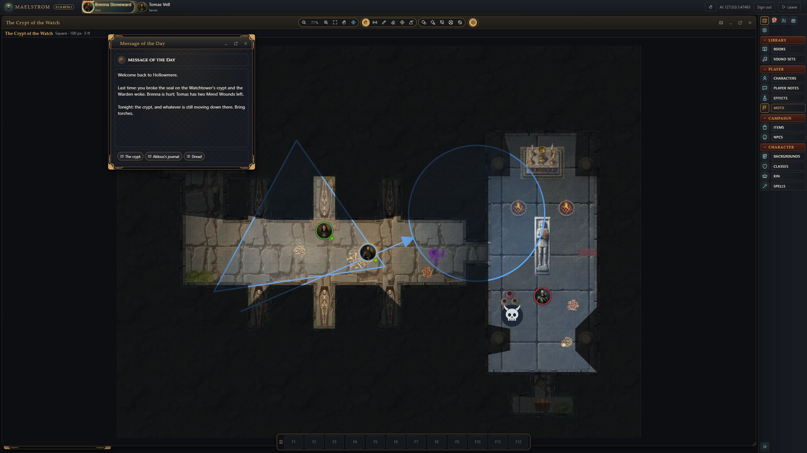

# Hosting and inviting

The GM's copy of Kraken is the table: it serves every player's browser. This page covers starting a table on your home network or over the internet, inviting players, the firewall, and the GM's controls for the people at the table (pause, bell, kick and ban).

## Starting the table

Select a campaign on the start screen, then set:

- **Your name:** what players see you called.
- **Port:** 47300 unless you change it.
- **Password:** leave it blank for an open table.
- **Players connect over:** **LAN** for players on your home network, **Internet** for players on the internet, or both.

Press **Play**. *Addresses to give your players* lists the addresses to share, written as `http://address:port`.

## Players on the internet

With **Internet** on, leave *Open the port on my router by itself (UPnP)* ticked. Kraken asks your router to open the port while you host (UPnP, or NAT-PMP) and closes it again when you stop. The Players window says whether it worked.

If your router has UPnP turned off, forward the port yourself in the router's settings: 47300 by default, TCP, to this PC.

## The firewall

- **Windows installer:** adds the firewall rule for you.
- **Running from source on Windows:** Windows asks once, the first time you host.
- **Linux:** if a firewall is on (such as `ufw`), allow the port yourself: `sudo ufw allow 47300/tcp`.

## Inviting players

The Players window's **Invite** is a link with the table password already in it. The password sits after the `#`, the part of a link a browser never sends to a server.

- Press **Copy** and paste the link in your group's chat.
- Or show its QR code to a player sitting with you.
- When you host on both LAN and Internet, choose the internet link or your network's.

A player opens the link, types their name and their own password, and sits down. Players who join from a plain address type the table password themselves. See [Joining a table](players-joining.md).

## Player accounts

Each player's name and password is their account at this table: it keeps their seat and their characters theirs. In the Players window the GM can list the accounts, make one ahead of time, set a new password, or remove one.

## The GM's controls

### Pause

The pause button beside *Hosting* (or `/pause` in chat) puts a veil over the players' screens. Their tokens stay put and their rolls wait until you press **Go on**. Chat goes on, and you can still do everything as usual. Pause also holds a player finishing the character wizard or improving a character.

### The Players window

Each player's row has a bell and a **⋯** menu. Right-click a row, or a character's portrait along the top of the screen, for the same menu:

| Item | What it does |
|---|---|
| **Ring bell** | A chime and a flash on that player's screen alone. |
| **View as** | Your map through that player's eyes. |
| **Mark away** | Dims their portrait. |
| **Kick** | Sends them away from the table. |
| **Ban** | They cannot sit at this table again, by name and from the address they came from, until you press **Unban** in the Players window's *Banned* list. |

### Away, hands and dropped connections

- **Away:** a player who types `/afk`, or does nothing for five minutes, has their portrait dimmed.
- **Raised hands:** a player's hand button (top right) raises a hand. You hear a chime and see the hand on their portrait and row.
- **Dropped connection:** a player whose Wi-Fi drops sees *Reconnecting…* over the table and sits back down in the same seat by themselves. You see them as *reconnecting* meanwhile, and their portrait stays. Your own window does the same if its connection drops.

### Message of the Day

**Message of the Day** (sidebar) is what players see as they join. Drag a map, an NPC or a page into it to link it.

