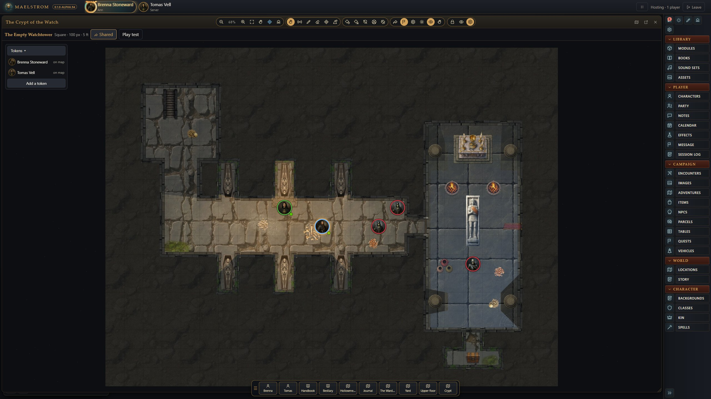

# Maelstrom VTT Wiki

Maelstrom VTT is a free virtual tabletop. The game master (GM) runs Maelstrom on a Windows or Linux PC and hosts the table. Players join from their browser (Chrome, Edge, Brave or Firefox) with nothing to install, or from the Maelstrom app. Maelstrom keeps the campaign, decides what each player may see, and serves every player's browser. This wiki explains how to use it, from your first campaign to the tools for experienced GMs.

> **Maelstrom is in alpha.** The version is in the app's title bar. Expect rough edges, and please report what you find (see [Troubleshooting and FAQ](troubleshooting-and-faq.md)).

## What Maelstrom does

- **You host, players use a browser.** Make a campaign, press Play, and give your players the address. They see only what you let them see. Hidden tokens, GM notes and secret doors never reach their browsers.
- **Ten games come in the box**, each with its rules, a character wizard, a sheet, books and a first adventure or starter with maps.
- **Your Fantasy Grounds library.** If you own Fantasy Grounds modules, Maelstrom reads them where they are: books, story, encounters, NPCs, items, and maps with walls, doors and lights.
- **Maps that play.** Walls and doors, line of sight, light and darkness, fog of war, weather, a shared ruler, and Map Studio, Maelstrom's own map maker.
- **A combat tracker that does the work.** It rolls attacks, damage, saves and initiative by each game's rules and applies the results.
- **3D dice, sound and music**, a calendar, a party sheet, treasure parcels and the bookkeeping of arrows, rations and torches.
- **A multi-monitor GM.** Every window can pop out to another screen.
- **AI-first.** Every GM action is also a tool an AI agent can use.

## The games it plays

| Comes with Maelstrom | Plays from your own books |
|---|---|
| Descending Darkness (Maelstrom's own, dark fantasy) | Castles & Crusades |
| Apeira Astra (Maelstrom's own, science fiction) | D&D 3.5E |
| D&D 5E, from the SRD 5.2.1 | AD&D 2E |
| Basic Fantasy RPG, 4th Edition | Traveller (Mongoose 2E) |
| Cairn, Second Edition | Worldbuilding (no rules, any game) |
| Ironsworn (with Delve) and Starforged | |
| Fate Core and Fate Accelerated | |
| Forged in the Dark | |

D&D 5E is in both columns: it plays from the SRD with nothing else installed, and your own 5E books add to it. See [Games](games.md) for each one.

## Where to start

- **New GM?** Read the [Quickstart](quickstart.md). It takes you from install to your first fight in ten steps.
- **Learning the ropes?** The [Tutorials](tutorials.md) walk through revealing monsters, running a fight, range, languages, treasure and group saves.
- **A player?** Read [Joining a table](players-joining.md). All you need is a browser (Chrome, Edge, Brave or Firefox) and the address your GM sends you.
- **Coming from Fantasy Grounds?** Maelstrom uses FG's words wherever it can: the sidebar, the lock on record windows, the modifier box, quick slots, `/rollon`. Start with [Records, books and packs](records-books-and-packs.md).

## Every page

| Getting going | Running the game | At the table |
|---|---|---|
| [Quickstart](quickstart.md) | [Maps and scenes](maps-and-scenes.md) | [Dice and chat](dice-and-chat.md) |
| [Installing and updates](installing-and-updates.md) | [Map Studio](map-studio.md) | [Character sheets and wizards](character-sheets-and-wizards.md) |
| [Campaigns and backups](campaigns-and-backups.md) | [Tokens, vision and lighting](tokens-vision-and-lighting.md) | [Bookkeeping and rest](bookkeeping-and-rest.md) |
| [Hosting and inviting](hosting-and-inviting.md) | [Combat tracker](combat-tracker.md) | [Sound and music](sound-and-music.md) |
| [Joining a table (players)](players-joining.md) | [Targeting and effects](targeting-and-effects.md) | [Settings](settings.md) |
| [Games](games.md) | [Records, books and packs](records-books-and-packs.md) | [Keyboard and mouse](keyboard-and-mouse.md) |
| | [Story, notes and handouts](story-notes-and-handouts.md) | [AI agent tools](ai-agent-tools.md) |
| | | [Troubleshooting and FAQ](troubleshooting-and-faq.md) |
| | | [Release notes](release-notes.md) |

## Licence

Maelstrom VTT is free to use, and its source is public under the PolyForm Shield License 1.0.0. You may use it for anything, including paid games, streaming and teaching. You may not use it to make a product that competes with it. The licence's own text decides. Each open game's text keeps its own licence; see [Games](games.md).
