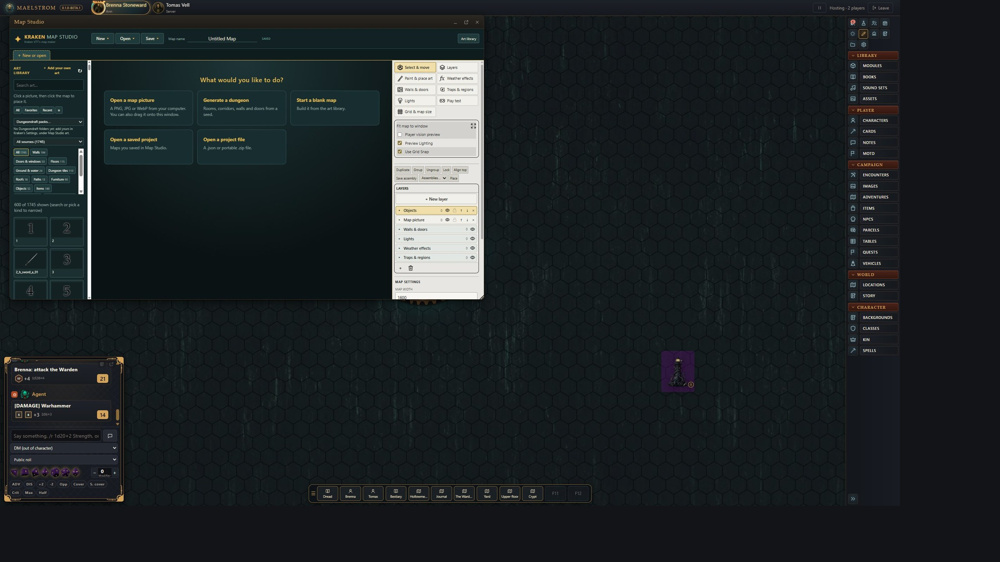

# Map Studio

Map Studio is Kraken's own map maker, built into the GM's app. You paint a map from art packs, draw walls, doors and windows with art along them, add lights, time of day and weather, mark traps and regions, generate a dungeon, play test it, and save it straight into the campaign. Open it with the pen along the top of the sidebar.

## What it can do

- **Paint** floors and art from your packs, and stamp props.
- **Generate a dungeon** to start from.
- **Walls, doors and windows**, drawn with wall art along them that also blocks line of sight.
- **Lights and time of day.**
- **Weather**, painted into areas with masks.
- **Traps and regions:** traps, pits, difficult terrain and teleports, which then play at the table (see [Maps and scenes](maps-and-scenes.md#traps-and-regions)).
- **Play test** the map from a token's view.

## The art it uses

- **Kraken Map Art**, Kraken's own pack, comes with it, with fantasy and sci-fi pieces (starship decks, hatches and consoles, docks and canal cobbles, barrow stones, coffins, a trapdoor and more).
- **Battle Map Forge's** generator and pack come with it too, with its author's permission.
- **Your own art packs:** your Fantasy Grounds art packs and Dungeondraft packs, read where they are.

Tell Kraken where your packs are in **Settings > Map Studio art** (the GM's):

- **Dungeondraft packs:** folders holding `.dungeondraft_pack` files.
- **Art packs:** folders holding art packs (`.mod`).

Nothing is assumed. Your Fantasy Grounds modules folder is read anyway. Press **Add a folder…** to add one, and the × beside a folder to stop reading it.

## Editing an existing image

1. Open the image in the image window.
2. Press **Open in Map Studio** on the window's bar. The image opens with its walls, doors, lights and weather.
3. Make your changes.
4. Press **Save to Kraken**. The walls, doors, lights and weather go back into the image, and what you painted becomes the image's picture, wherever it is opened.

The next time, Map Studio opens it as you left it. A region you switched off at the table stays off after Save to Kraken.

## Saving

- **Save to Kraken** writes the map into the open image, or into a new scene in the campaign's images.
- Map Studio inside Kraken makes maps for Kraken. Exporting to Fantasy Grounds or Foundry is the job of the stand-alone Map Studio app.

## Let an AI agent build a map

An AI agent (Claude Code, or any agent on Kraken's MCP server) can make maps in Map Studio for you with its `kraken_map_studio` tool. Ask it for a map of a place: it opens Map Studio and builds it in a tab of its own while you watch, from the same art and tools, then saves it into your campaign. You can take over with the mouse at any point. Its guide for the agent is the `kraken-map-studio` skill. See [AI agent tools](ai-agent-tools.md).
