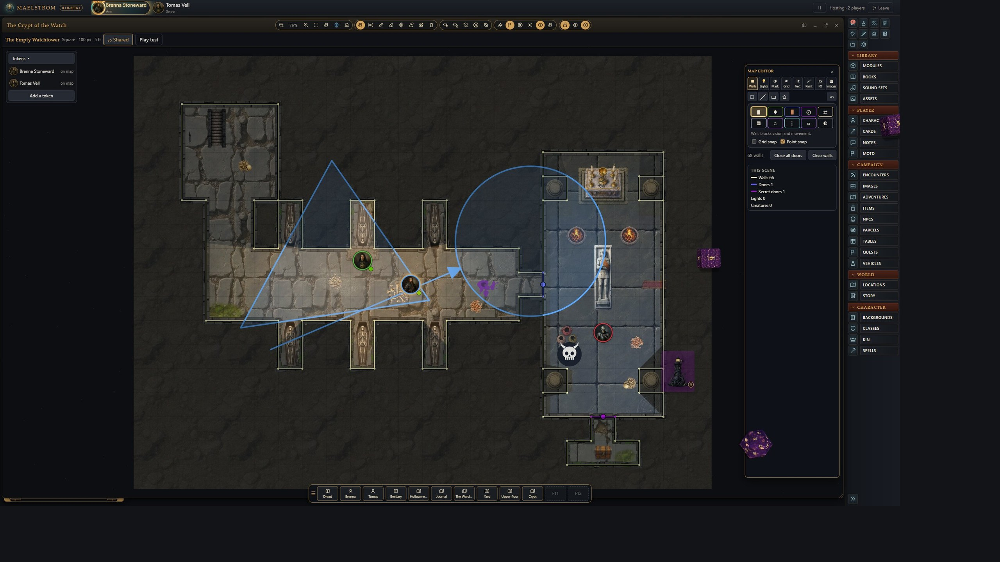
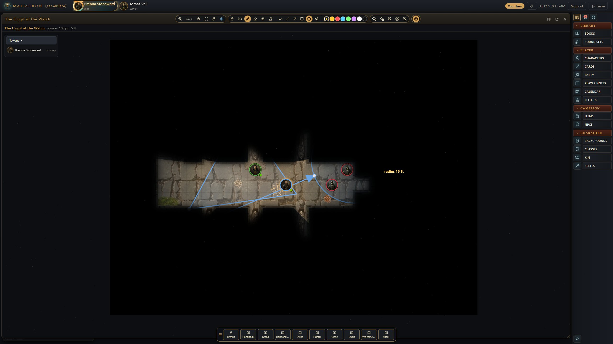
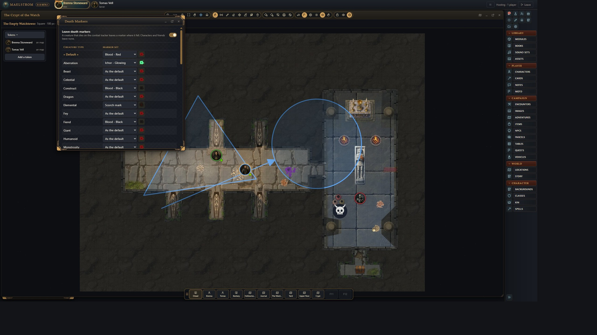
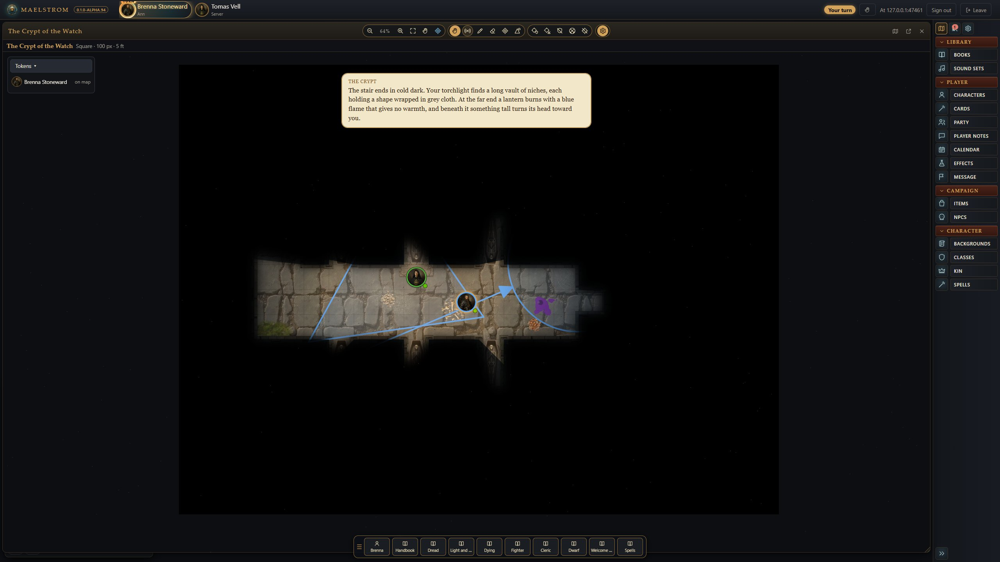

# Maps and scenes

Maps in Maelstrom work like Fantasy Grounds' images: every picture you see opens in the image window, and each picture has one master copy that keeps its walls, doors, lights, paint, effects and tokens. This page covers opening and sharing maps, the image window and its tools, the map editor, and what happens on a map during play. Tokens, sight and light have their own page: [Tokens, vision and lighting](tokens-vision-and-lighting.md).

## Opening a map

Click any picture to open it in the image window:

- on a book's page, or in its **Images & Maps** tab;
- in **Campaign > Images** (every picture of every active book, and the campaign's own under *This campaign*);
- in the **Library** (the sidebar's Adventures: its **Maps** tab shows each map, and a click lets you look at it before it goes to the table);
- from a story entry, or a quick slot;
- or drop a picture on the table.

Nothing shown is a dead end. Every place that opens a picture opens the same master, so walls you draw in one place are there in all the others. The map window can be moved, resized and popped out to another monitor. A picture from a book opens only once that book is active (see [Records, books and packs](records-books-and-packs.md)).

## Sharing with the players

- An image you open is **yours alone** (**Not shared**) until you choose **Share**. Then it is the players' map, and it opens on every player's screen, even where a player closed it.
- The table's map shows **Shared**. Click it to stop sharing (the players see no map), and again to share.
- Sharing a map shows its name across the players' screens for a moment.
- **Close** goes back to the table's map.

### Pull players to my view

The players button in the map's tools glides every player's map to what you see now. With the ping tool, Shift+click pulls them to that spot as it pings. A player in the middle of a drag is asked instead.

## The image window

**The corner:**

- **Locked / Unlocked:** unlocked opens the editor at the side.
- **The eye:** player vision preview. What your players see: their tokens' sight, the light, the dark and the fog they have explored.
- **Tools:** shows or hides the tool strip. Locked with the tools hidden, you see the picture alone.

**The tool strip:** zoom, fit, the **navigation pad** (buttons to pan and zoom), find a token, pan, ping, draw, erase, area target, and for the GM: share, pins (the map's shortcuts shown or hidden), scene settings, a light, line of sight, and token movement lock.

**Open in Map Studio** (on the image window's bar) opens the image in Maelstrom's map maker with its walls, doors, lights and weather. See [Map Studio](map-studio.md).

## Assets

**Library > Assets** shows every picture of your active books and art packs, by folder. A picture's preview offers:

- **Make it a map:** it joins Campaign > Images under *This campaign* and opens to edit.
- **Share:** the players see the picture.
- **Set as background.**

## The map editor

Unlock a map to edit it.

- **Walls, doors and windows:** drawn where your hand puts them, snapping to the grid and to wall ends. Maps from your Fantasy Grounds modules and Maelstrom's own adventures bring their walls and doors with them.
- **Grid:** square or hex, its size and offset.
- **Lights:** placed on the map, with colour and animation. A light's right-click menu can turn it into **magical darkness**.
- **Masks:** hide parts of the map from players.
- **Paint, text and pins:** pins can link to story and records.
- **Weather and effects:** painted into areas with masks.
- **Image layers:** pictures placed on the map, below or above the tokens, ordered, hidden, locked or grouped.

All of it applies to the same master image wherever it is opened. Lock it again to play.

## Scene settings

The **Scene** settings (in the tool strip) hold the scene's darkness, weather and grid, including its own rule for diagonals. They also hold:

- **Reset explored:** forgets the fog of war for one player or everyone.
- **Sounds on this map:** places a sound from your library in the middle of the view. Each player hears it when their tokens are near, louder nearer, muffled through walls. See [Sound and music](sound-and-music.md).

## Play test

**Play test** puts a test token on the image and shows it as a player sees it (walls, doors, light, darkness). Drag the token to look for gaps, then **End play test** and the token goes. The table's map has Play test too.

## At play on the map

### Measuring

Right-drag to measure. While it is held, a left click (or Space) drops a waypoint and Backspace takes the last one back. Each leg's length shows at its end and the whole by the pointer. Everyone on the map sees your ruler as you draw it, in your colour. From one token to another the ruler counts their difference in height too.

How a diagonal counts is **Settings > Tokens and measuring > Diagonals**: every square one, 5-10-5, or a straight line. A scene can set its own in its Scene settings (Grid).

### Shapes

With the pen, choose a free line, a straight line, an arrow, a square, a circle (drag from its centre) or a cone (drag from its point). Each is measured in feet as you draw it, in your colour. With the pen out, drag a shape's handles to resize it. Players can draw too.

### Pings

The ping tool marks a spot for everyone, in your colour.

### Traps and regions

Traps and regions from Map Studio (and a Foundry bundle's regions) play at the table:

- A **trap** or **pit** stops a player's token on its first square, tells you its name and note in a line only you see, and locks movement until you unlock it.
- **Difficult terrain** costs more on the ruler.
- A **teleport** sends whoever steps in to the region it names.

You see regions as faint outlines; players never get them.

### Animated maps

A map whose picture is a video (`.webm` or `.mp4`, as Foundry's animated scenes) plays as the map for everyone.

### Death markers

A creature that dies leaves a mark where it fell: blood in its colour, a skull, a tombstone, bones or a scorch mark. **Settings > Death Markers** chooses the set each creature type leaves. Right-click a marker to remove it; the map's skull button clears them all.

### Read aloud

Boxed text in an adventure (FG's frames) has a speech button for the GM. Its words go to chat and appear over everyone's map.

