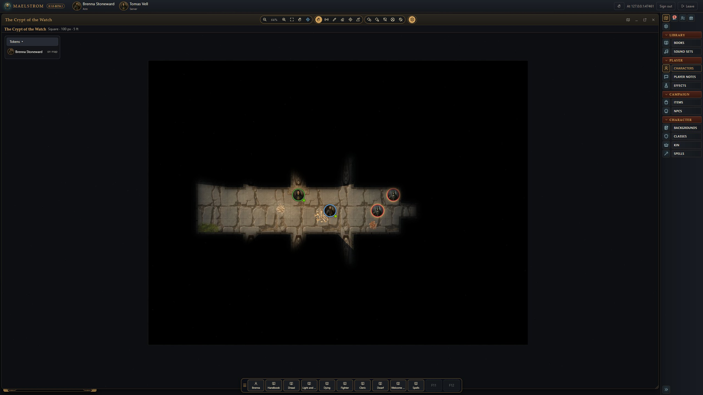
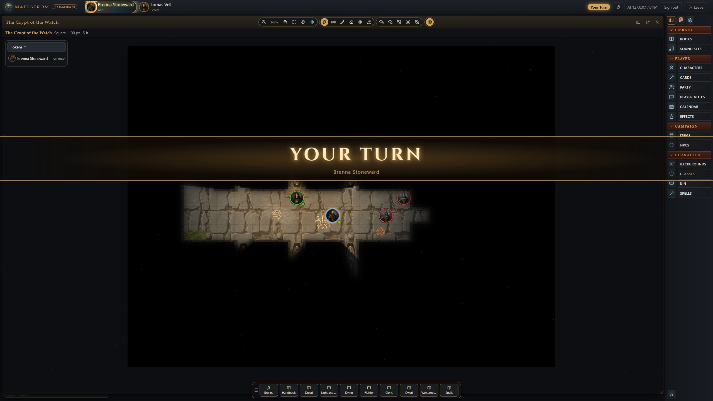
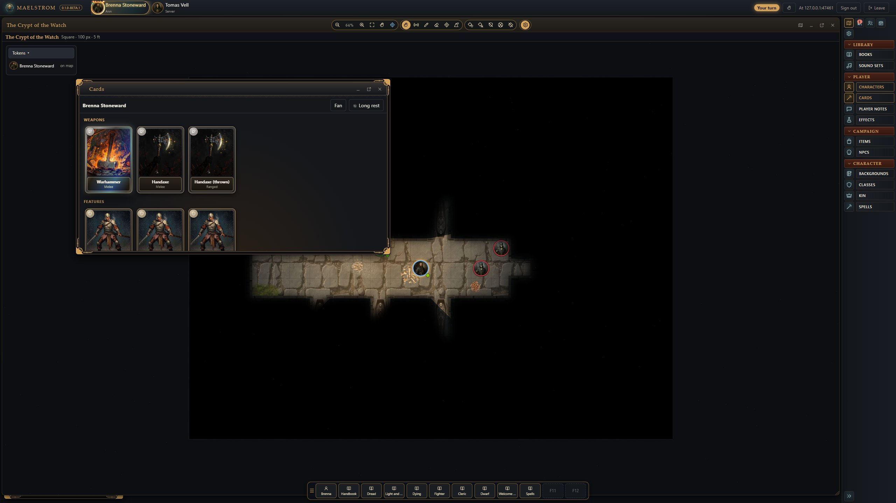

# Joining a table (players)

This page is for players. You need only a web browser: Chrome, or another Chromium browser such as Edge, on a desktop or laptop computer. Phones are not supported. You install nothing; your GM's copy of Kraken serves the whole table.

## Joining

1. Open the link or address your GM gave you, such as `http://203.0.113.5:47300`.
2. Type **your name** and choose **your password**. The first time at a table you choose it; it keeps your seat and your characters yours. The browser remembers you next time.
3. If the GM set a **table password** and sent you a plain address, type it too. An invite link already carries it.
4. Press **Take your seat**.

If you lose your connection, Kraken shows *Reconnecting…* and puts you back in the same seat by itself. If you closed the tab, open the address again: you come back to the same seat.

## Your character

- Open **Characters**. It shows Character Selection: every character you may take, as cards.
- Press **New character** (a figure with a plus) to open the game's character wizard. It walks you through each step: for Descending Darkness, kin, class, background and abilities; for Apeira Astra, Origin, Paths and skills. Rolls in the wizard are made by the host, in chat for the table.
- Click a card to open its **sheet**. Click a skill, save or attack on it to roll it.
- Drag items, spells and other links from the books the GM shares onto your sheet.

More in [Character sheets and wizards](character-sheets-and-wizards.md).

## Rolling

- Click anything on your sheet that can be rolled.
- Type `/r 1d20+2` in chat to roll any dice.
- The **modifier box** by the dice adds to your next roll.
- Rolls and their results show in chat for everyone, unless someone rolls in secret.

All the dice and chat commands are in [Dice and chat](dice-and-chat.md).

## On the map

You see the map the GM shares, through your token's eyes. Walls block your view, and darkness hides what your light does not reach. Places you have seen stay dimly shown after you move on (fog of war), on any browser you join from.

- **Move:** drag your own token. The distance shows as you drag: green within your speed, amber within a dash, red past both. It warns; it never stops you.
- **Undo a move:** Ctrl+Z takes your token's last move back.
- **Measure:** right-drag. Everyone sees your ruler in your colour.
- **Draw:** with the pen, draw lines, arrows, squares, circles and cones, each measured in feet as you draw.
- **Locked movement:** if the GM has locked movement, your drag waits for the GM to accept it.

More in [Tokens, vision and lighting](tokens-vision-and-lighting.md).

## In combat

- When the GM starts combat, the **combat tracker** shows the turn order.
- When your turn comes round, a banner sweeps across your screen and a soft chime sounds (you can turn either off in **Settings > You at the table**).
- On your turn, target a creature (click its token), then roll your attack and damage from your sheet or the tracker. Hits and damage apply by themselves.
- In Descending Darkness, when a friend is dying, the **Steady** button in the tracker tries to stop the bleeding.

## Ability cards

If you like spell cards on the table, turn on **Ability cards** in **Settings**. A **Cards** button appears in the sidebar. It opens your spells and weapons as cards, grouped by level.

- **Click a card** to turn it over: its full text, and **Cast** (or **Attack** and **Damage** for a weapon).
- **Drag a card onto a creature's token** to target it and cast or attack in one move.
- A spell card **tips over and goes grey** when you have no slot of its level or higher left. **Long rest** gives every slot back and stands the cards up.
- The spell you are concentrating on **glows**. Turn it over and press **End** to stop.
- **Fan** shows the cards as a hand; **Spread** lays them out in rows.
- The cards show your sheet: spending a slot on the sheet tips the card, and the other way round. **Card effects** in Settings turns the movement off.

## Chat

Type to talk. `/` lists the commands, and `/help` shows all of them. Some you will use often:

- `/r 1d20+3` rolls dice.
- `/w Name message` whispers to someone (`/w GM` to the GM, or `/gm message`).
- `/ooc message` speaks out of character.
- `/me draws her sword` says what you do.
- `/afk` marks you away; type it again to come back.

## Being at the table

- **Raise your hand** with the hand button (top right). The GM hears a chime.
- **Your colour** (Settings > You at the table) rings your tokens and colours your pings and drawings.
- The **Calendar** lets you write notes on a day, signed in your colour.
- You can export the chat you saw from the chat's corner.
