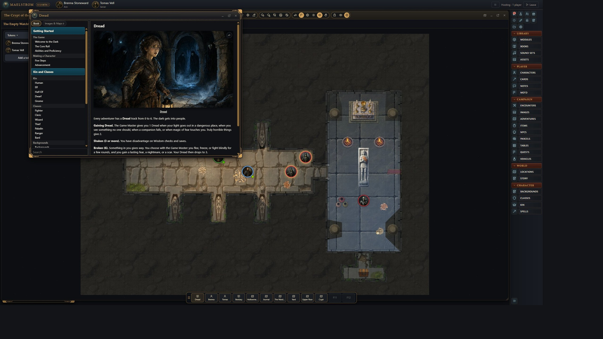

# Records, books and packs

Kraken reads books: rulebooks, bestiaries and adventures, with their pictures, maps and links. Its own games' books come with it; your Fantasy Grounds modules are read where they are; and Kraken packs (`.kpack`) make each of your books one file that opens anywhere. This page covers the sidebar, books and modules, packs, sharing with players, and editing records.

## The sidebar

The sidebar on the right holds everything, as Fantasy Grounds' does:

| Part | What is in it |
|---|---|
| **Tools along the top** | The combat tracker, the assistant (the AI agent), Map Studio, the players, settings. |
| **Library** | Modules (every module and pack for the campaign's game), Books (the active books, to read), Assets, Sound Sets. |
| **Player** | Characters, Party (the party sheet), Notes. |
| **Campaign** | Encounters, Images (maps and handouts), Items, NPCs, Parcels, Quests, Tables. |
| **World** | Story (each active adventure's story entries, and the campaign's own). |
| **Character** | The game's own lists (classes and races, or Paths and Origins) to drag onto a character. |

The categories fold away, and the arrow at the bottom collapses the sidebar to icons. Every window can be moved, resized and **popped out** to its own window on another monitor. Its sidebar button closes it wherever it is.

**Everything is a link.** Anything that looks like a link can be dragged: onto a sheet, into chat, into a story entry, onto a quick slot.

## Books and modules

- **Kraken's own games' books** are always on the shelf for their campaigns, and the SRD 5.2.1 books for a D&D 5E campaign.
- **Your Fantasy Grounds modules:** Kraken reads them in place from your Fantasy Grounds data folder's `modules` folder. Nothing is copied. (Set the `KRAKEN_BOOKS` environment variable to read another folder.) A campaign's game decides which modules fit it.
- **Make a book active** in **Modules** to bring its records (NPCs, items, encounters, maps, story) into the campaign. A book that is not active is off limits: its pages, pictures, maps and records open only once it is.
- **Books** lists only the active books, to read. A player sees only the ones you open to them; a players' book can be shared with the players.
- Every list (Items, NPCs, Spells and the rest) shows every active book's records under the book's name.

### Links in a book

Links work as in Fantasy Grounds: a page, a picture, or a record the book holds (a creature, spell, item, class, race, feat, table, encounter) opens in its own window. A table shows as a table, an equipment list as its sections, and a web link opens in your browser. Dice a page names are chips you click to roll.

## Kraken packs

A Kraken pack (`.kpack`) is one book in one file: a rulebook, a bestiary, an adventure, a map or token pack. It is Kraken's equivalent of a Fantasy Grounds `.mod` or a Foundry compendium pack.

- **Make packs** in **Modules**, on the **Packs** tab: **Make pack** for one book, or **Make N packs** for all of them. Each pack holds the book's pages, records, maps with walls and doors, and pictures.
- **Where they go:** `Documents/Kraken VTT/Packs` (on Linux, `~/Documents/Kraken VTT/Packs`). Set `KRAKEN_PACKS` for another folder. **Open folder** on the Packs tab opens it.
- **On another computer:** install Kraken, create that folder, and copy the `.kpack` files into it. The books open there with no Fantasy Grounds at all.
- **Pack or module:** Kraken reads the pack in place of the module, unless the module is newer. Choose **Make again** after you change a module.
- **Kraken's own games' books** are packs too, and come with Kraken. A pack of your own with the same name is read instead.

**Packs made from your books are yours alone.** Keep them to yourself; never share them.

For the technical layout, see [kraken-pack-format.md](../kraken-pack-format.md).

## Sharing with the players

Players never see what you have not shared.

- **The eye** on a record's window or its list row opens a menu: **Everyone**, each player (tick as many as you like), or **GM only**.
- **Drag** a record, note, story or picture onto a player's portrait along the top to share it with that player alone.
- A picture's right-click menu has **Show to** each player.

## Editing records

- **New** (on the NPCs, Items and other lists, as Fantasy Grounds' +) makes a record and opens it. A Traveller NPC opens on its own sheet: its six characteristics, skills, armour and weapons, which the tracker fights with.
- **The pencil** in a record's window (Fantasy Grounds' lock) unlocks it: its fields (the game's own list, else the fields that kind of record carries; **+ Field** adds one of your own) and its description in the text editor. Click the lock to read it again.
- **Right-click a row** for **Duplicate** (a copy named "(copy)") and **Delete**. **Undo** shows for a few seconds.
- **Copy to campaign** on a book's record lets you change it without touching the book.

## Identifying items

An item's window has **Identified**, and the name and notes the players see until it is ticked. Unidentified, the players see only those: in the lists, on character sheets, on the combat tracker, in the party sheet's parcel and in chat. The real item never reaches their browsers.

## Random tables

**Campaign > Tables** holds the campaign's tables and the books' alike.

- **New**, or **Import a table**: paste the rows, as `1-3  words`, or comma, pipe, colon or semicolon separated.
- Every table's window has **Roll** (a column, or **GM only**). Unlocked, it edits the die, the columns and every row.
- In a result, `[2d6]` is rolled, `[3x]` rolls the tables it links three times, and `[Other Table]` rolls that table.
- Drag a result from the table's window into the chat's entry.
- In chat: `/rollon Rumours -c Column -d 2d6 -hide`.

## Encounters, parcels and quests

- **Encounters** (Campaign > Encounters): see [Combat tracker](combat-tracker.md#encounters).
- **Parcels:** see [Character sheets and wizards](character-sheets-and-wizards.md#parcels-and-treasure).
- **Quests** (Campaign > Quests): XP, text and status. Drop one on the party sheet's XP tab.

## Importing from Fantasy Grounds

Kraken reads Fantasy Grounds modules (`.mod`) in place and can import their content into a campaign. Maps from them bring their walls, doors and lights. Kraken also reads Foundry scene bundles' regions (see [Maps and scenes](maps-and-scenes.md#traps-and-regions)).
