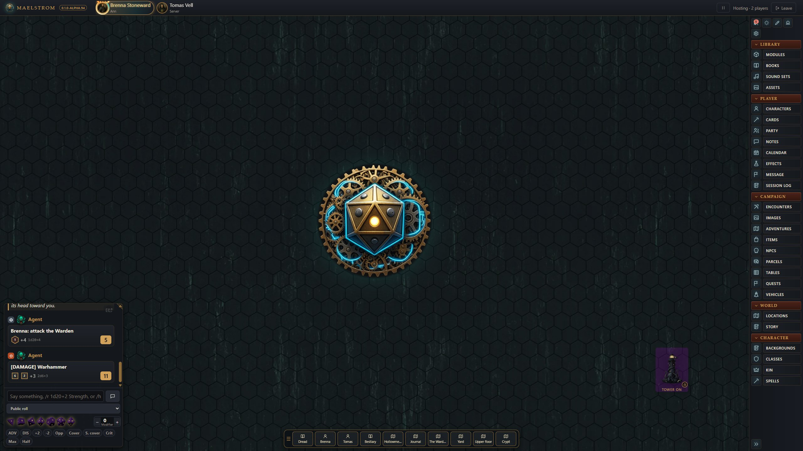

# Settings

Settings (the cog, or `/settings`) holds everyone's own preferences and the GM's table options. Players see only the parts that are theirs. This page goes through each part, and describes the `Documents/Kraken VTT` folder where everything you add to Kraken lives.

## For everyone

### Dice

Opens the **Dice** window: your dice sets, colours, design, material, lettering, effects, the crit flare, 3D and sound, and your NPC and damage dice. See [Dice and chat](dice-and-chat.md).

### You at the table

- **Your colour:** rings your tokens and colours your pings and drawings, so everyone knows who is who. **Auto** takes the table's colour for your name, or pick any colour.
- **Chime on your turn:** a soft chime when your turn comes round in combat.
- **Banner on your turn:** your name across the screen when it is your turn.

### Ability cards

- **Spells and weapons as cards:** a Cards button in the sidebar with your character's abilities as painted cards.
- **Card effects:** flips, foil and sparks.

## For the GM

### The buttons along the top

| Button | Opens |
|---|---|
| **Background Decal** | The emblem in the middle of the table. |
| **Desktop Wallpaper** | Seamless tiles behind the desktop. |
| **GM Icon** | Your picture beside what you say in chat. |
| **Critical Hits & Fumbles** | The critical hit and fumble tables' window. |
| **Death Markers** | The set each creature type leaves where it dies. |
| **Kraken VTT Folder** | Opens `Documents/Kraken VTT`. |
| **Open logs** | Kraken's logs, for a bug report. |

Decals, wallpapers and GM icons each offer Kraken's own, a set for each game, **Browse…** to import a picture of your own, or none.

### Dice and the dice tower

- **Players see their own tower rolls:** off, only you see what goes into the dice tower, as in Fantasy Grounds.
- **Dice tower on the table:** the tower stands apart from the chat, for everyone; each person places it where they like. Off, it sits in the chat.
- **The tower's look:** six drawn looks, painted towers, or a picture of your own.
- **Dice stay on the table:** seconds the landed dice stay before they fade, for everyone.

### Combat

Clear targets, Initiative, Creatures' hit points, Roll initiative every round, Stop at the start of each round, Skip turns, NPC numbering, Token effects and Apply damage. Each is explained in [Combat tracker](combat-tracker.md#the-trackers-options).

### Bookkeeping

Ammunition, Consumables, Rations and water, Light from the pack, Encumbrance and bag space, and Variant encumbrance. See [Bookkeeping and rest](bookkeeping-and-rest.md).

### Tokens and measuring

- **Creatures' health** and **Characters' health:** what players see, as a bar, a dot, either on hover, or off.
- **Token names:** on hover, always, or off.
- **Diagonals:** every square counts one, 5-10-5, or a straight line.

What is off is never sent to a player's browser. See [Tokens, vision and lighting](tokens-vision-and-lighting.md).

### The game's own settings

Some games add their own rows here, shown only in that game.

### Map Studio art

The folders of your Dungeondraft packs and your art packs (`.mod`). See [Map Studio](map-studio.md#the-art-it-uses).

## Your Kraken VTT folder

Everything you add to Kraken lives in `Documents/Kraken VTT` (Settings > **Kraken VTT Folder** opens it), one folder for each kind of thing:

| Folder | What goes in it |
|---|---|
| Packs | Your books (`.kpack`) |
| Dice | Dice packs: more dice sets for everyone |
| Dice Towers | Tower pictures (with a `lit` twin if you like) |
| GM Icons | Your picture beside what you say in chat |
| Background Decals | The emblem in the middle of the table; in a folder named for a game (`D&D 3.5e`), they show under its filter |
| Wallpapers | Seamless tiles behind the desktop |

Each folder's README says what goes in it and how to make one. `AGENTS.md` says the same for an AI agent, so you can ask one to make dice, towers or wallpapers for you. Pictures you add with **Browse…** are copied into the right folder. Back up the whole folder to keep what you made.

## Screen size

`/scaleui 125` makes everything on your screen bigger or smaller (50 to 200; 100 is normal). It is kept in that browser. `/scaledice` and `/scaleroll` size the tray's dice and the rolled dice.
