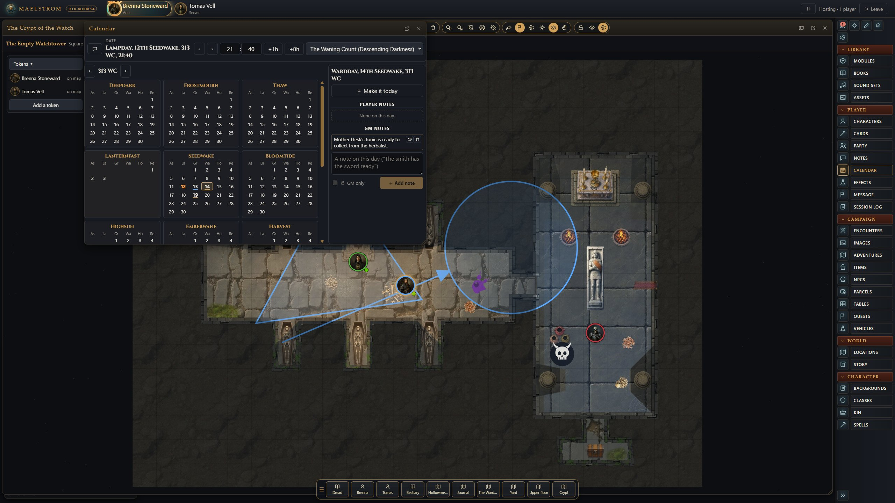

# Story, notes and handouts

Story entries, notes, handouts, the calendar and the message of the day are how the GM tells the story and the players keep track of it. This page covers the text editor, the campaign's story, notes, handouts and pictures, read-aloud text, the calendar and quick slots for the GM's prep.

## The text editor

Notes, story pages, quests and descriptions share one text editor. Its bar gives bold, italic, underline, a heading, a list, boxed read-aloud text, a table and plain text.

Drag anything into it (a book page, a picture, a character, a sound, a note, a record) and it becomes a chip in the words that opens with a click. Dice in the text (`[[1d20+3]]`, or "2d6 + 3 fire") are chips you click to roll. Text is saved as you leave the field.

## Story

**World > Story** lists the campaign's own story entries above the adventures' entries, by chapter.

- **New** makes one of the campaign's own. It has a chapter, an order, and pages. Unlock it with the pen in its window to write: the buttons at the foot add a page of text, two columns, a heading, a picture, a picture on the left or right with text beside it, or a separator line (scrollwork, knot, double rule, stars). Drag a picture or a book page onto it for a page of its own.
- Each page has a **frame and colour** button: parchment, two read-aloud boxes, sidebar, note, warning, stone or gilded, and any background colour. The arrows move a page, the bin removes it. Lock it again to read it as a book.
- An adventure's entry has **Copy to campaign**, so you can change it without touching the book.
- **Share** an entry and the players find it under their own **Story**, its pictures included.

## Notes

- **Notes** (sidebar, Player > Notes) are for the GM and the players.
- **Notes from chat:** drag any chat line into a note, or onto Player Notes to start one.
- Clicking a roll chip while typing in a note only places the cursor; it does not roll.

## Handouts and pictures

- Every picture of every active book is in **Campaign > Images**, and in **Library > Assets** by folder.
- **Share** a picture from its preview to show it to every player, or use its right-click menu's **Show to** for one player.
- Drag a picture onto a player's portrait to share it with that player alone.

See [Records, books and packs](records-books-and-packs.md#sharing-with-the-players).

## Read aloud

Boxed text in an adventure, and story pages in a read-aloud frame, have a speech button for the GM. Its words go to chat and appear over everyone's map as a speech bubble; the × on the bubble closes it, and its window button opens a **Read aloud** window (every read-aloud of the session, newest first) to move or pop out; while that window is open, read-alouds go there instead. Anyone who would rather read it in the chat only turns off **Read aloud on screen** in Settings > You at the table. `/story text` in chat posts story text without a name.

## The Calendar

**Calendar** (sidebar) is your game's calendar: Greyhawk, Harptos, Golarion, Traveller's Imperial date, and Maelstrom's own, depending on the game.

- Move the day on, add 8 hours for a rest, set the time, say the date in chat.
- Click a day for its page and write a note there. Players see it, unless you tick **GM only**.
- Players write their own notes, signed in their colour.
- With bookkeeping on, each day that ends on the calendar has the party eat and drink (see [Bookkeeping and rest](bookkeeping-and-rest.md)).

## Message of the Day

**Message of the Day** (sidebar) is what players see as they join. Drag a map, an NPC or a page into it to link it.

## Quick slots

The quick slots along the bottom keep ten things at hand: a book or a page, a map, a character, a sound, a note, dice, or a chat line. Click a slot, or press its number key (1 to 9, then 0), to use it. See [Keyboard and mouse](keyboard-and-mouse.md#quick-slots).
