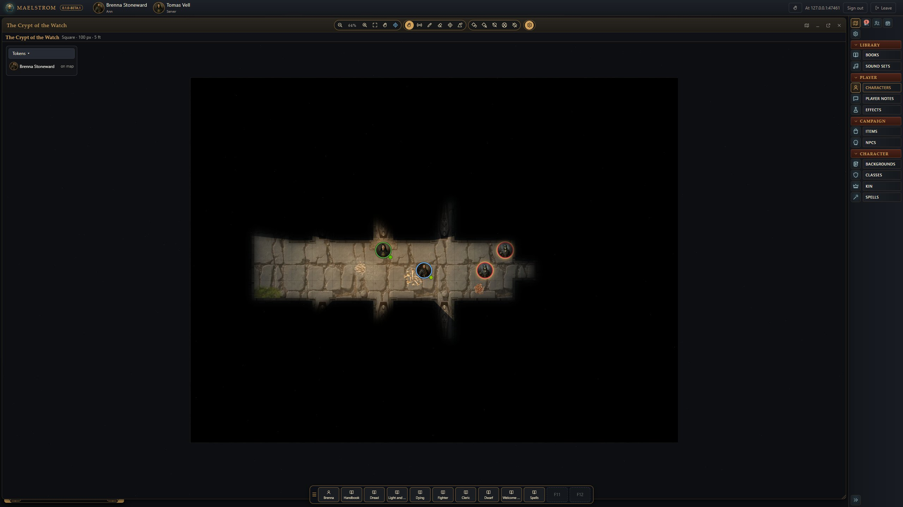

# Tokens, vision and lighting

Players see a map only through their own tokens' eyes. Walls block sight, doors open and close, and darkness hides what no light reaches. This page covers placing and moving tokens, what players see of them, senses and light, fog of war, and the GM's movement controls.

## Placing tokens

- Drag a character or NPC onto the map to place its token.
- A token's right-click menu holds its options.
- A **hidden** token never reaches the players. Select a token and press **H** to hide or show it (GM).
- Encounters can place all their creatures at once with **Place on this map** (see [Combat tracker](combat-tracker.md#encounters)).

### The GM's keys for tokens

With the pointer over the map:

- **Ctrl+A** selects every token.
- **Ctrl+C** and **Ctrl+V** copy tokens and paste them at the pointer, laid out as they were. The copies are kept across scenes.
- **Delete** (or Backspace) removes the selected token.

All the keys are on [Keyboard and mouse](keyboard-and-mouse.md).

## Moving tokens

- **Drag** a token to move it. The distance shows as you drag: green within its speed (the sheet's Speed), amber within a dash, red past both. It warns; it never stops the move.
- **Arrow keys** move the selected token a square; the **number pad** moves diagonally too (7, 9, 1, 3).
- **Undo a move:** Ctrl+Z (or the token menu's **Undo move**) takes a token's last move back. A player undoes their own; the GM any.
- **This turn's path:** in combat, a token's moves this turn are drawn faintly with how far that was. The path starts again when its turn begins.

### Locked movement

The tool strip's token movement lock stops players moving freely. A player can still drag their token: the move waits on your screen as a dashed line to where they want to go, and in the **Moves waiting** strip, with **Accept** and **Cancel** for each and for all.

### Elevation

**Alt+wheel** over a token raises or lowers it by a square's distance (or use the token menu's **Elevation**). A badge shows its height to everyone, and the ruler counts the difference in height between tokens.

## What players see on tokens

**Settings > Tokens and measuring** (the GM's), as Fantasy Grounds' options:

- **Creatures' health** and **Characters' health:** a bar, a bar on hover, a dot, a dot on hover, or off.
- **Token names:** on hover, always, or off.

What is off is never sent to a player's browser. The same health setting decides what players see in the combat tracker.

A token's right-click menu has **Players call it**: the name players see until they know better ("a hooded figure"). The tracker and chat use that name for players too.

## Senses

A token's menu shows its senses, read from its character's senses line, or from its own **Senses** line you type (for example "Darkvision 60 ft, Blindsight 10 ft").

- **Darkvision** sees in the dark to its range.
- **Blindsight** perceives what is near, even in the dark.
- **Tremorsense** feels creatures on the ground, through walls.
- **Truesight** and **Devil's Sight** see in magical darkness.

## Light and darkness

- A scene's **darkness** is set in its Scene settings. Players see light as a glow.
- **Map lights** are placed in the map editor (or in Map Studio), with colour and animation.
- **Magical darkness:** a light's right-click menu (map editor, Lights) turns it into magical darkness, black for players whatever else lights it.
- **Carried light:** a torch dropped on a token (from the Effects window) lights the map around it and moves with it. It burns an hour of game time, warns, and goes out; it can be put out and lit again. With bookkeeping on, lighting one takes a torch from the pack (see [Bookkeeping and rest](bookkeeping-and-rest.md)).

## Fog of war

What each player has seen of a map stays dimly shown after their tokens move on. Kraken's host keeps it, per player and map, saved with the campaign, so it is there on any browser they join from.

- **Scene > Reset explored** forgets it for one player or everyone.
- The **eye** in the image window's corner (player vision preview) shows it.

## Checking what players see

- The **eye** (player vision preview) shows your players' view on your own map.
- **View as** (a player's menu in the Players window) shows your map through that one player's eyes.
- **Play test** puts a test token on the map to look for gaps in the walls.
